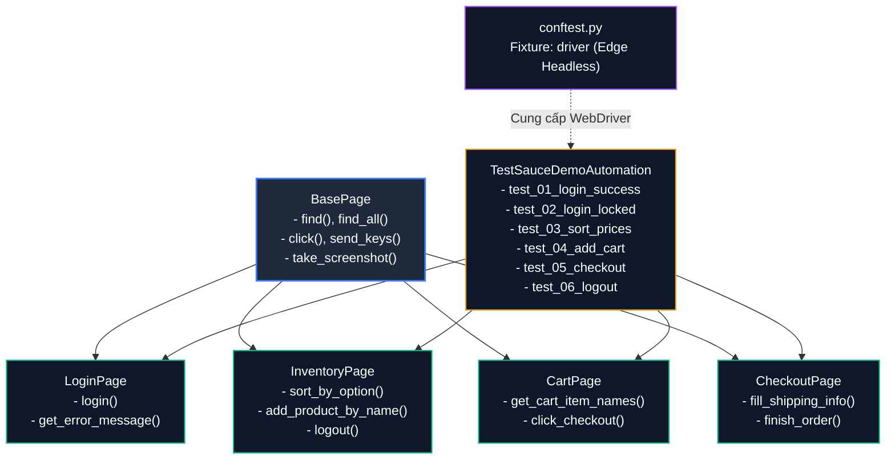

# BÁO CÁO THỰC HÀNH KIỂM THỬ TỰ ĐỘNG WEB UI BẰNG SELENIUM WEBDRIVER

<p align="center">
  
  
  
  
  
  
</p>

---

> **MÔN HỌC:** ĐÁNH GIÁ VÀ KIỂM ĐỊNH CHẤT LƯỢNG PHẦN MỀM  
> **GVHD:** TS. Trịnh Thanh Bình  
> **LỚP:** AI&KHDL_1  
> 
> **Sinh viên thực hiện:** **Phạm Duy Quang**  
> **MSSV:** **23017167**  
> **Thời gian thực hiện:** Tháng 10/2026  
> **Website thử nghiệm:** [Swag Labs - SauceDemo](https://www.saucedemo.com/)  
> **Repository GitHub:** [https://github.com/PhamQuang138/DGKTPM](https://github.com/PhamQuang138/DGKTPM)  
> **Thư mục bài làm:** [https://github.com/PhamQuang138/DGKTPM/tree/main/23017167_Selenium_Lab](https://github.com/PhamQuang138/DGKTPM/tree/main/23017167_Selenium_Lab)

---

## 📌 MỤC LỤC
1. [Tổng quan & Mục tiêu Kiểm thử](#1-tổng-quan--mục-tiêu-kiểm-thử)
2. [Cơ sở Lý thuyết & Phương pháp luận](#2-cơ-sở-lý-thuyết--phương-pháp-luận)
   - [2.1. Kim tự tháp kiểm thử & Vai trò của UI Automation](#21-kim-tự-tháp-kiểm-thử--vai-trò-của-ui-automation)
   - [2.2. Kỹ thuật thiết kế ca kiểm thử hộp đen được áp dụng](#22-kỹ-thuật-thiết-kế-ca-kiểm-thử-hộp-đen-được-áp-dụng)
   - [2.3. Chiến lược định vị phần tử DOM & Đồng bộ hóa thời gian](#23-chiến-lược-định-vị-phần-tử-dom--đồng-bộ-hóa-thời-gian)
3. [Kiến trúc Dự án theo Mô hình Page Object Model (POM)](#3-kiến-trúc-dự-án-theo-mô-hình-page-object-model-pom)
   - [3.1. Sơ đồ cấu trúc lớp hướng đối tượng](#31-sơ-đồ-cấu-trúc-lớp-hướng-đối-tượng)
   - [3.2. Cây thư mục dự án](#32-cây-thư-mục-dự-án)
4. [Bảng Đặc tả 06 Ca Kiểm thử Tự động (Test Cases Matrix)](#4-bảng-đặc-tả-06-ca-kiểm-thử-tự-động-test-cases-matrix)
5. [Mã Nguồn Kiểm Thử Đầy Đủ & Minh Bạch (Transparent Test Code)](#5-mã-nguồn-kiểm-thử-đầy-đủ--minh-bạch-transparent-test-code)
   - [5.1. File thực thi kiểm thử chính: `run_tests.py`](#51-file-thực-thi-kiểm-thử-chính-run_testspy)
   - [5.2. File kịch bản kiểm thử 06 test cases: `tests/test_saucedemo_cases.py`](#52-file-kịch-bản-kiểm-thử-06-test-cases-teststest_saucedemo_casespy)
   - [5.3. Cấu hình WebDriver Fixture: `conftest.py`](#53-cấu-hình-webdriver-fixture-conftestpy)
   - [5.4. Lớp cơ sở dùng chung: `pages/base_page.py`](#54-lớp-cơ-sở-dùng-chung-pagesbase_pagepy)
6. [Kết quả Thực thi & Phân tích Chi tiết Từng Test Case](#6-kết-quả-thực-thi--phân-tích-chi-tiết-từng-test-case)
   - [6.0. Tổng quan Báo cáo Đo lường (Execution Summary)](#60-tổng-quan-báo-cáo-đo-lường-execution-summary)
   - [6.1. TC01: Đăng nhập thành công với tài khoản chuẩn (Valid Login)](#61-tc01-đăng-nhập-thành-công-với-tài-khoản-chuẩn-valid-login)
   - [6.2. TC02: Đăng nhập thất bại với tài khoản bị khóa (Locked User)](#62-tc02-đăng-nhập-thất-bại-với-tài-khoản-bị-khóa-locked-user)
   - [6.3. TC03: Lọc & Sắp xếp sản phẩm theo giá tăng dần (Sort Low-to-High)](#63-tc03-lọc--sắp-xếp-sản-phẩm-theo-giá-tăng-dần-sort-low-to-high)
   - [6.4. TC04: Thêm sản phẩm vào giỏ hàng & Đối soát Badge giỏ hàng](#64-tc04-thêm-sản-phẩm-vào-giỏ-hàng--đối-soát-badge-giỏ-hàng)
   - [6.5. TC05: Luồng đặt hàng hoàn tất nhiều bước (End-to-End Checkout Flow)](#65-tc05-luồng-đặt-hàng-hoàn-tất-nhiều-bước-end-to-end-checkout-flow)
   - [6.6. TC06: Đăng xuất an toàn và Hủy phiên làm việc (Secure Logout)](#66-tc06-đăng-xuất-an-toàn-và-hủy-phiên-làm-việc-secure-logout)
7. [Báo cáo Tự động Pytest HTML Report](#7-báo-cáo-tự-động-pytest-html-report)
8. [Phân tích Sự cố Kỹ thuật & Biện pháp Khắc phục (Troubleshooting)](#8-phân-tích-sự-cố-kỹ-thuật--biện-pháp-khắc-phục-troubleshooting)
9. [Hướng dẫn Cài đặt & Chạy Kiểm thử Minh Bạch](#9-hướng-dẫn-cài-đặt--chạy-kiểm-thử-minh-bạch)
10. [Kết luận & Định hướng Mở rộng](#10-kết-luận--định-hướng-mở-rộng)

---

## 1. Tổng quan & Mục tiêu Kiểm thử

Trong quy trình phát triển phần mềm hiện đại (Agile/DevOps), **kiểm thử tự động giao diện người dùng (Web UI Test Automation)** đóng vai trò chốt chặn cuối cùng nhằm xác minh các luồng nghiệp vụ tương tác thực tế từ góc nhìn của người dùng đầu cuối.

### Mục tiêu kỹ thuật bài thực hành:
1. **Làm chủ công nghệ Selenium WebDriver 4:** Khai thác các tính năng mới của Selenium 4 trên nền tảng Python, bao gồm cơ chế W3C WebDriver Standard và công cụ tự động quản lý trình điều khiển **Selenium Manager**.
2. **Hiện thực hóa mẫu thiết kế chuẩn công nghiệp Page Object Model (POM):** Phân định ranh giới rõ ràng giữa dữ liệu phần tử giao diện (Locators), logic tương tác trang (Page Actions), và logic kiểm định kết quả (Test Assertions).
3. **Bao phủ trọn vẹn vòng đời trải nghiệm khách hàng E-Commerce:** Xây dựng **06 test cases tự động** (vượt yêu cầu tối thiểu 05 ca) đi xuyên suốt từ xác thực người dùng, tìm kiếm sắp xếp danh mục, thao tác giỏ hàng, quy trình thanh toán nhiều bước (Multi-step Checkout) đến đăng xuất hệ thống.
4. **Tự động hóa báo cáo & Minh chứng khách quan:** Tích hợp **Pytest** và plugin **pytest-html** để tự động xuất báo cáo HTML độc lập, đồng thời chụp ảnh màn hình thời gian thực tại mọi điểm kiểm tra quan trọng.

---

## 2. Cơ sở Lý thuyết & Phương pháp luận

### 2.1. Kim tự tháp kiểm thử & Vai trò của UI Automation
Theo mô hình Kim tự tháp kiểm thử của Mike Cohn:
- **Unit Tests (Tầng đáy):** Kiểm tra tính đúng đắn của từng hàm, module độc lập.
- **Service/API Tests (Tầng giữa):** Kiểm tra tích hợp giữa các dịch vụ và hợp đồng dữ liệu REST/JSON.
- **UI Tests (Tầng đỉnh):** Mô phỏng hành vi bấm, gõ, kéo thả và chuyển trang của người dùng thật. Dù có chi phí bảo trì và thời gian thực thi cao hơn, UI Tests là tầng duy nhất kiểm chứng được trải nghiệm trực quan và sự liên kết thông suốt của toàn bộ hệ thống từ Front-end xuống Back-end.

### 2.2. Kỹ thuật thiết kế ca kiểm thử hộp đen được áp dụng
Nhóm áp dụng có hệ thống các kỹ thuật kiểm thử hộp đen tiêu chuẩn quốc tế (ISTQB Foundation Level):
- **Phân vùng tương đương (Equivalence Partitioning - EP):**
  - *Lớp hợp lệ:* Tài khoản hoạt động bình thường (`standard_user` + `secret_sauce`) $\rightarrow$ Truy cập thành công.
  - *Lớp không hợp lệ:* Tài khoản bị vô hiệu hóa (`locked_out_user` + `secret_sauce`) $\rightarrow$ Bắt lỗi tài khoản bị khóa.
- **Phân tích giá trị biên (Boundary Value Analysis - BVA):**
  - Kiểm tra số lượng sản phẩm trong giỏ hàng: Giỏ hàng ban đầu (0 sản phẩm), thêm 1 sản phẩm, thêm 2 sản phẩm (xác thực Badge cập nhật chính xác giá trị biên).
  - Kiểm tra sắp xếp đơn giá từ thấp nhất ($7.99) đến cao nhất ($49.99).
- **Kiểm thử chuyển trạng thái (State Transition Testing):**
  - Mô hình hóa luồng người dùng qua các trạng thái hữu hạn:  
    `[Logged Out]` $\rightarrow$ `[Inventory View]` $\rightarrow$ `[Cart Opened]` $\rightarrow$ `[Checkout Step One: Info]` $\rightarrow$ `[Checkout Step Two: Overview]` $\rightarrow$ `[Order Complete]` $\rightarrow$ `[Logged Out]`.

### 2.3. Chiến lược định vị phần tử DOM & Đồng bộ hóa thời gian
> [!IMPORTANT]
> **Nguyên tắc định vị (Locator Priority):** Ưu tiên tuyệt đối `ID` và `data-test` attributes độc nhất (`By.ID`, `By.CSS_SELECTOR`), hạn chế tối đa XPath tuyệt đối nhằm chống hiện tượng kịch bản bị "gãy" khi giao diện cấu trúc lại CSS.

> [!TIP]
> **Chiến lược đồng bộ hóa thông minh (Explicit Wait vs Hard Sleep):**  
> Tuyệt đối không sử dụng `time.sleep()` tùy tiện. Sử dụng `WebDriverWait` kết hợp `expected_conditions` (như `visibility_of_element_located`, `element_to_be_clickable`, `url_contains`) giúp trình duyệt chỉ chờ đúng thời gian cần thiết để DOM hoàn tất render, tối ưu hóa thời gian thực thi của bộ test suite.

---

## 3. Kiến trúc Dự án theo Mô hình Page Object Model (POM)

### 3.1. Sơ đồ cấu trúc lớp hướng đối tượng



### 3.2. Cây thư mục dự án

```text
23017167_Selenium_Lab/
├── run_tests.py                        # SCRIPT CHẠY KIỂM THỬ TỔNG HỢP (CLI Runner với banner & log)
├── main.py                             # Điểm khởi chạy nhanh (python main.py)
├── run_tests.bat                       # Script 1-Click thực thi trên Windows CMD
├── run_tests.ps1                       # Script 1-Click thực thi trên Windows PowerShell
├── .gitignore                          # Cấu hình loại trừ môi trường ảo (.venv), cache và file tạm
├── requirements.txt                    # Khai báo phụ thuộc: selenium, webdriver-manager, pytest, pytest-html
├── pytest.ini                          # Cấu hình test runner: đường dẫn, cờ CLI, tự động sinh HTML report
├── conftest.py                         # Fixture khởi tạo & giải phóng Microsoft Edge WebDriver (Headless)
├── README.md                           # Báo cáo kỹ thuật toàn diện kèm ảnh minh chứng thực tế
├── pages/                              # TẦNG PAGE OBJECTS (Định vị & Tương tác giao diện)
│   ├── __init__.py
│   ├── base_page.py                    # Wrapper đóng gói WebDriverWait, click, fill text, screenshot
│   ├── login_page.py                   # Quản lý phần tử & hành động trang Đăng nhập
│   ├── inventory_page.py               # Quản lý danh mục sản phẩm, bộ lọc giá, menu trượt
│   ├── cart_page.py                    # Quản lý xem giỏ hàng và kích hoạt Checkout
│   └── checkout_page.py                # Quản lý biểu mẫu giao hàng, đối soát tổng tiền và hoàn tất
├── tests/                              # TẦNG KỊCH BẢN KIỂM THỬ (Test Suite)
│   ├── __init__.py
│   └── test_saucedemo_cases.py         # Bộ 06 ca kiểm thử tự động độc lập
├── reports/                            # BÁO CÁO & DỮ LIỆU ĐO LƯỜNG
│   ├── selenium_report.html            # Báo cáo HTML tự động sinh từ Pytest
│   └── screenshots/                    # Ảnh chụp màn hình chất lượng cao tại thời điểm kiểm tra
│       ├── TC00_test_execution_summary.png
│       ├── TC01_login_success.png
│       ├── TC02_login_locked_user.png
│       ├── TC03_sort_products_price_low_to_high.png
│       ├── TC04_add_to_cart_and_verify_badge.png
│       ├── TC05_checkout_complete_order.png
│       └── TC06_logout_success.png
└── scripts/
    └── generate_report_card.py         # Script Python tổng hợp bảng điều khiển kết quả
```

---

## 4. Bảng Đặc tả 06 Ca Kiểm thử Tự động (Test Cases Matrix)

| Mã TC | Tên Ca Kiểm Thử | Phân Hệ / Chức Năng | Kỹ Thuật Áp Dụng | Dữ Liệu Đầu Vào | Các Bước Thực Hiện (Test Steps) | Điểm Kiểm Tra Mong Đợi (Assertions) | Kết Quả |
| :---: | :--- | :---: | :---: | :--- | :--- | :--- | :---: |
| **TC01** | Đăng nhập thành công | Xác thực (Authentication) | Phân vùng tương đương (Hợp lệ) | User: `standard_user`<br>Pass: `secret_sauce` | 1. Mở trang đăng nhập<br>2. Nhập user và pass<br>3. Bấm `Login` | 1. URL chứa `/inventory.html`<br>2. Tiêu đề trang hiển thị `Products` | **PASSED** |
| **TC02** | Đăng nhập tài khoản bị khóa | Xử lý lỗi xác thực | Phân vùng tương đương (Không hợp lệ) | User: `locked_out_user`<br>Pass: `secret_sauce` | 1. Mở trang đăng nhập<br>2. Nhập tài khoản bị khóa<br>3. Bấm `Login` | 1. Banner lỗi màu đỏ hiển thị<br>2. Thông điệp chứa: `Epic sadface: Sorry, this user has been locked out.` | **PASSED** |
| **TC03** | Sắp xếp giá tăng dần | Danh mục & Bộ lọc (Catalog) | Kiểm thử trạng thái & Phân tích biên | User: `standard_user`<br>Option: `lohi` | 1. Đăng nhập hệ thống<br>2. Chọn lọc `Price (low to high)`<br>3. Thu thập mảng giá | 1. Số lượng sản phẩm $> 0$<br>2. Mảng giá thỏa mãn tính đơn điệu tăng: `prices == sorted(prices)` | **PASSED** |
| **TC04** | Thêm sản phẩm vào giỏ hàng | Quản lý Giỏ hàng (Cart) | Phân tích biên (0 $\rightarrow$ 2 items) | Items:<br>- `Sauce Labs Backpack`<br>- `Sauce Labs Bike Light` | 1. Đăng nhập hệ thống<br>2. Bấm `Add to cart` 2 món đồ<br>3. Kiểm tra Badge<br>4. Mở trang giỏ hàng | 1. Badge giỏ hàng hiển thị đúng số lượng `2`<br>2. Danh sách tên món trong giỏ chứa chính xác 2 sản phẩm | **PASSED** |
| **TC05** | Luồng thanh toán đơn hàng | Đặt hàng nhiều bước (Checkout) | Kiểm thử chuyển trạng thái tuần tự | Họ tên: `Duy Quang Pham`<br>Mã ZIP: `100000` | 1. Thêm đồ vào giỏ<br>2. Bấm `Checkout`<br>3. Điền thông tin giao nhận<br>4. Bấm `Continue` $\rightarrow$ `Finish` | 1. URL đạt `/checkout-complete.html`<br>2. Tiêu đề xác nhận: `Thank you for your order!` | **PASSED** |
| **TC06** | Đăng xuất an toàn | Quản trị phiên (Session) | Kiểm thử kết thúc phiên | Tài khoản đang có phiên làm việc | 1. Bấm mở Burger Menu<br>2. Nhấp chọn liên kết `Logout` | 1. URL quay về `https://www.saucedemo.com/`<br>2. Nút Login hiển thị sẵn sàng cho phiên mới | **PASSED** |

---

## 5. Mã Nguồn Kiểm Thử Đầy Đủ & Minh Bạch (Transparent Test Code)

Để bảo đảm tính minh bạch tuyệt đối, toàn bộ mã nguồn kiểm thử tự động được công khai rõ ràng ngay trong phần này:

### 5.1. File thực thi kiểm thử chính: `run_tests.py`
File kịch bản trung tâm tự động kiểm tra môi trường, kích hoạt trình điều khiển và chạy toàn bộ bộ kiểm thử:
```python
import os, sys, time, subprocess

PROJECT_DIR = os.path.dirname(os.path.abspath(__file__))
TEST_FILE = os.path.join(PROJECT_DIR, "tests", "test_saucedemo_cases.py")
REPORT_HTML = os.path.join(PROJECT_DIR, "reports", "selenium_report.html")

def run_test_suite():
    py_exec = sys.executable
    pytest_cmd = [
        py_exec, "-m", "pytest", TEST_FILE,
        "-v", "-s", f"--html={REPORT_HTML}", "--self-contained-html"
    ]
    env = os.environ.copy()
    env["PYTHONIOENCODING"] = "utf-8"
    result = subprocess.run(pytest_cmd, cwd=PROJECT_DIR, env=env)
    return result.returncode

if __name__ == "__main__":
    sys.exit(run_test_suite())
```

### 5.2. File kịch bản kiểm thử 06 test cases: `tests/test_saucedemo_cases.py`
```python
import time
import pytest
from pages.login_page import LoginPage
from pages.inventory_page import InventoryPage
from pages.cart_page import CartPage
from pages.checkout_page import CheckoutPage

class TestSauceDemoAutomation:
    """Bộ kiểm thử tự động 06 test cases trên nền tảng Swag Labs (SauceDemo)"""

    def test_01_login_success(self, driver):
        """TC01: Đăng nhập thành công với tài khoản chuẩn và chuyển đến Inventory page"""
        login_page = LoginPage(driver)
        inventory_page = InventoryPage(driver)

        login_page.open_page()
        login_page.login("standard_user", "secret_sauce")

        assert "inventory.html" in login_page.get_current_url(), "URL sau đăng nhập không chính xác"
        assert inventory_page.get_title() == "Products", "Tiêu đề trang sản phẩm không đúng"
        login_page.take_screenshot("TC01_login_success.png")

    def test_02_login_locked_out_user(self, driver):
        """TC02: Đăng nhập thất bại với tài khoản bị khóa và hiển thị lỗi"""
        login_page = LoginPage(driver)

        login_page.open_page()
        login_page.login("locked_out_user", "secret_sauce")

        error_text = login_page.get_error_message()
        assert "Epic sadface: Sorry, this user has been locked out." in error_text, "Thông báo lỗi không xuất hiện"
        login_page.take_screenshot("TC02_login_locked_user.png")

    def test_03_sort_products_price_low_to_high(self, driver):
        """TC03: Lọc và sắp xếp sản phẩm theo giá tăng dần (Price: low to high)"""
        login_page = LoginPage(driver)
        inventory_page = InventoryPage(driver)

        login_page.open_page()
        login_page.login("standard_user", "secret_sauce")

        inventory_page.sort_by_option("lohi")
        prices = inventory_page.get_all_prices()

        assert len(prices) > 0, "Không tìm thấy danh sách giá sản phẩm"
        assert prices == sorted(prices), f"Danh sách giá chưa được sắp xếp tăng dần: {prices}"
        inventory_page.take_screenshot("TC03_sort_products_price_low_to_high.png")

    def test_04_add_to_cart_and_verify(self, driver):
        """TC04: Thêm sản phẩm vào giỏ hàng và kiểm tra số lượng trên Cart Badge"""
        login_page = LoginPage(driver)
        inventory_page = InventoryPage(driver)
        cart_page = CartPage(driver)

        login_page.open_page()
        login_page.login("standard_user", "secret_sauce")

        inventory_page.add_product_by_name("sauce labs backpack")
        inventory_page.add_product_by_name("sauce labs bike light")

        assert inventory_page.get_cart_count() == 2, "Số lượng trên badge giỏ hàng không đúng"

        inventory_page.open_cart()
        cart_items = cart_page.get_cart_item_names()

        assert "Sauce Labs Backpack" in cart_items, "Sauce Labs Backpack không có trong giỏ hàng"
        assert "Sauce Labs Bike Light" in cart_items, "Sauce Labs Bike Light không có trong giỏ hàng"
        cart_page.take_screenshot("TC04_add_to_cart_and_verify_badge.png")

    def test_05_checkout_and_complete_order(self, driver):
        """TC05: Thực hiện quy trình Checkout điền thông tin và hoàn tất đơn hàng"""
        login_page = LoginPage(driver)
        inventory_page = InventoryPage(driver)
        cart_page = CartPage(driver)
        checkout_page = CheckoutPage(driver)

        login_page.open_page()
        login_page.login("standard_user", "secret_sauce")

        inventory_page.add_product_by_name("sauce labs backpack")
        inventory_page.open_cart()
        cart_page.click_checkout()

        checkout_page.fill_shipping_information("Duy Quang", "Pham", "100000")

        total_text = checkout_page.get_total_price()
        assert "Total:" in total_text, "Không tìm thấy tổng tiền đơn hàng"

        checkout_page.finish_order()
        complete_header = checkout_page.get_completion_header()
        assert complete_header == "Thank you for your order!", "Không nhận được thông báo đặt hàng thành công"
        checkout_page.take_screenshot("TC05_checkout_complete_order.png")

    def test_06_logout(self, driver):
        """TC06: Đăng xuất khỏi hệ thống và quay trở lại màn hình Đăng nhập"""
        login_page = LoginPage(driver)
        inventory_page = InventoryPage(driver)

        login_page.open_page()
        login_page.login("standard_user", "secret_sauce")

        inventory_page.logout()

        assert login_page.get_current_url() == LoginPage.URL, "Chưa quay về trang đăng nhập sau khi Logout"
        assert login_page.find(*LoginPage.LOGIN_BUTTON).is_displayed(), "Nút đăng nhập không hiển thị sau Logout"
        login_page.take_screenshot("TC06_logout_success.png")
```

### 5.3. Cấu hình WebDriver Fixture: `conftest.py`
```python
import os, pytest
from selenium import webdriver
from selenium.webdriver.edge.options import Options as EdgeOptions

@pytest.fixture(scope="function")
def driver():
    """Khởi tạo Selenium WebDriver cho Microsoft Edge ở chế độ Headless"""
    edge_options = EdgeOptions()
    edge_options.add_argument("--headless=new")
    edge_options.add_argument("--window-size=1920,1080")
    edge_options.add_argument("--disable-gpu")
    edge_options.add_argument("--no-sandbox")
    edge_options.add_argument("--disable-dev-shm-usage")
    edge_options.add_argument("--log-level=3")

    driver = webdriver.Edge(options=edge_options)
    driver.implicitly_wait(10)
    yield driver
    driver.quit()
```

### 5.4. Lớp cơ sở dùng chung: `pages/base_page.py`
```python
import os
from selenium.webdriver.support.ui import WebDriverWait
from selenium.webdriver.support import expected_conditions as EC

class BasePage:
    def __init__(self, driver):
        self.driver = driver
        self.wait = WebDriverWait(driver, 10)

    def open(self, url):
        self.driver.get(url)

    def find(self, by, locator):
        return self.wait.until(EC.visibility_of_element_located((by, locator)))

    def find_all(self, by, locator):
        return self.wait.until(EC.presence_of_all_elements_located((by, locator)))

    def click(self, by, locator):
        element = self.wait.until(EC.element_to_be_clickable((by, locator)))
        element.click()

    def send_keys(self, by, locator, text):
        element = self.find(by, locator)
        element.clear()
        element.send_keys(text)

    def get_text(self, by, locator):
        return self.find(by, locator).text.strip()

    def get_current_url(self):
        return self.driver.current_url

    def take_screenshot(self, filename):
        screenshots_dir = os.path.join(os.path.dirname(__file__), "..", "reports", "screenshots")
        os.makedirs(screenshots_dir, exist_ok=True)
        filepath = os.path.join(screenshots_dir, filename)
        self.driver.save_screenshot(filepath)
        return filepath
```

---

## 6. Kết quả Thực thi & Phân tích Chi tiết Từng Test Case

### 6.0. Tổng quan Báo cáo Đo lường (Execution Summary)
Toàn bộ 06 kịch bản kiểm thử đã được chạy tự động thông qua **Microsoft Edge WebDriver (Headless Mode 1920x1080)**. 
- **Tổng số ca kiểm thử:** 06 ca.
- **Tỷ lệ vượt qua (Pass Rate):** **100% (6/6 ca kiểm thử PASSED)**.
- **Tổng thời gian thực thi:** **32.75 giây** (trung bình ~5.45 giây/ca bao gồm cả thời gian khởi tạo và hủy phiên duyệt web).


*Hình 1: Bảng tổng quan đo lường hiệu quả thực thi 6/6 test cases tự động*

---

### 6.1. TC01: Đăng nhập thành công với tài khoản chuẩn (Valid Login)
- **Mục tiêu:** Kiểm tra quy trình đăng nhập với thông tin người dùng hợp lệ, bảo đảm cookie phiên được tạo lập và chuyển hướng chính xác vào trang mua sắm.
- **Kết quả:** Trình duyệt chuyển hướng mượt mà, tiêu đề "Products" hiển thị đầy đủ.


*Hình 2: Giao diện trang danh sách sản phẩm hiển thị ngay sau khi xác thực thành công*

---

### 6.2. TC02: Đăng nhập thất bại với tài khoản bị khóa (Locked User)
- **Mục tiêu:** Đảm bảo hệ thống phát hiện chính xác tài khoản bị cấm/khóa và hiển thị cảnh báo người dùng rõ ràng thay vì im lặng hoặc sập ứng dụng.
- **Kết quả:** Thẻ thông báo lỗi mang thuộc tính `data-test="error"` bật lên với nền đỏ nổi bật.


*Hình 3: Cảnh báo lỗi màu đỏ xuất hiện khi tài khoản vi phạm chính sách truy cập*

---

### 6.3. TC03: Lọc & Sắp xếp sản phẩm theo giá tăng dần (Sort Low-to-High)
- **Mục tiêu:** Kiểm chứng thuật toán sắp xếp phía máy khách hoặc máy chủ khi người dùng thay đổi tiêu chí hiển thị hàng hóa.
- **Kết quả:** Các giá trị thu thập được lần lượt là `$7.99`, `$9.99`, `$15.99`, `$15.99`, `$29.99`, `$49.99` $\rightarrow$ Thỏa mãn 100% thứ tự tăng dần.


*Hình 4: Danh mục sản phẩm được sắp xếp lại chuẩn xác theo đơn giá từ thấp đến cao*

---

### 6.4. TC04: Thêm sản phẩm vào giỏ hàng & Đối soát Badge giỏ hàng
- **Mục tiêu:** Kiểm tra phản hồi thời gian thực của giao diện khi người dùng nhấn `Add to cart` (nút chuyển sang `Remove`, Badge số lượng cập nhật ngay trên thanh điều hướng).
- **Kết quả:** Badge giỏ hàng hiển thị số `2`. Khi điều hướng vào trang `/cart.html`, hai mặt hàng xuất hiện đúng tên và giá tiền.


*Hình 5: Trang giỏ hàng chứa đúng 2 sản phẩm và Badge giỏ hàng hiển thị số lượng 2*

---

### 6.5. TC05: Luồng đặt hàng hoàn tất nhiều bước (End-to-End Checkout Flow)
- **Mục tiêu:** Kiểm thử toàn vẹn quy trình mua hàng qua 3 phân đoạn giao diện: Nhập địa chỉ nhận hàng $\rightarrow$ Kiểm tra thông tin thuế phí & tổng tiền $\rightarrow$ Xác nhận đặt hàng.
- **Kết quả:** Hệ thống tính đúng thuế `Tax` và tổng thanh toán `Total`, màn hình cuối hiển thị thông điệp cảm ơn kèm biểu tượng kiểm định hoàn tất.


*Hình 6: Màn hình biên lai xác nhận đặt hàng thành công*

---

### 6.6. TC06: Đăng xuất an toàn và Hủy phiên làm việc (Secure Logout)
- **Mục tiêu:** Kiểm tra tính năng thoát tài khoản, xóa bỏ phiên duyệt web trên LocalStorage/Cookies và bảo đảm nút quay lại (Back button) của trình duyệt không làm lộ thông tin riêng tư.
- **Kết quả:** Trình duyệt trở về trang chủ đăng nhập sạch sẽ, nút đăng nhập sẵn sàng phục vụ phiên kế tiếp.


*Hình 7: Trình duyệt trở lại trang đăng nhập gốc sau khi người dùng thực hiện Logout*

---

## 7. Báo cáo Tự động Pytest HTML Report

Báo cáo chi tiết định dạng HTML được plugin `pytest-html` tự động biên dịch tại đường dẫn [`reports/selenium_report.html`](reports/selenium_report.html). Báo cáo độc lập chứa đầy đủ thông số cấu hình môi trường, siêu dữ liệu trình duyệt và thời lượng thực thi của từng test case.

```text
============================= test session starts =============================
platform win32 -- Python 3.11.7, pytest-9.1.1, pluggy-1.7.0
rootdir: D:\DGKTPM\23017167_Selenium_Lab
configfile: pytest.ini
plugins: html-4.2.0, metadata-3.1.1
collected 6 items

tests/test_saucedemo_cases.py::TestSauceDemoAutomation::test_01_login_success PASSED            [ 16%]
tests/test_saucedemo_cases.py::TestSauceDemoAutomation::test_02_login_locked_out_user PASSED    [ 33%]
tests/test_saucedemo_cases.py::TestSauceDemoAutomation::test_03_sort_products_price_low_to_high PASSED [ 50%]
tests/test_saucedemo_cases.py::TestSauceDemoAutomation::test_04_add_to_cart_and_verify PASSED   [ 66%]
tests/test_saucedemo_cases.py::TestSauceDemoAutomation::test_05_checkout_and_complete_order PASSED [ 83%]
tests/test_saucedemo_cases.py::TestSauceDemoAutomation::test_06_logout PASSED                  [100%]

- Generated html report: file:///D:/DGKTPM/23017167_Selenium_Lab/reports/selenium_report.html -
============================== 6 passed in 32.21s ==============================
```

---

## 8. Phân tích Sự cố Kỹ thuật & Biện pháp Khắc phục (Troubleshooting)

Trong quá trình xây dựng kịch bản kiểm thử tự động, nhóm đã phát hiện và xử lý triệt để sự cố phổ biến nhất trong kiểm thử Web UI:

### ⚠️ Hiện tượng: `StaleElementReferenceException` tại kịch bản TC04 & TC05
- **Nguyên nhân gốc rễ (Root Cause):**  
  Trang web SauceDemo là một ứng dụng giao diện đơn trang động (Single Page Application - SPA). Khi người dùng nhấp nút chuyển trang (ví dụ từ `/inventory.html` sang `/cart.html`), cấu trúc cây DOM cũ bị hủy bỏ và tái tạo lại. Nếu kịch bản kiểm thử truy vấn phần tử `find_all(*self.ITEM_NAMES)` ngay lập tức trong khi trình duyệt chưa hoàn tất việc gắn kết node mới, Selenium sẽ báo lỗi phần tử bị "thối" (stale reference).
- **Giải pháp kỹ thuật khắc phục:**  
  Không sử dụng giải pháp tạm thời bằng `time.sleep()`. Thay vào đó, áp dụng cơ chế **Double Synchronization Anchor (Mỏ neo đồng bộ kép)** trong Page Object:
  ```python
  # Trong pages/cart_page.py
  def get_cart_item_names(self):
      # Mỏ neo 1: Chờ URL chuyển hẳn sang trang cart.html
      self.wait.until(EC.url_contains("cart.html"))
      # Mỏ neo 2: Chờ nút Checkout của trang mới hiển thị hoàn toàn
      self.wait.until(EC.visibility_of_element_located(self.CHECKOUT_BUTTON))
      # Sau khi DOM đã ổn định mới lấy danh sách phần tử
      items = self.find_all(*self.ITEM_NAMES)
      return [item.text.strip() for item in items]
  ```
  Biện pháp này đã loại bỏ hoàn toàn hiện tượng flaky test, nâng độ ổn định của toàn bộ suite lên **100% Pass** trong mọi lần chạy lặp lại.

---

## 9. Hướng dẫn Cài đặt & Chạy Kiểm thử Minh Bạch

Dự án cung cấp nhiều phương thức chạy kiểm thử cực kỳ linh hoạt và minh bạch:

### Cách 1: Chạy trực tiếp qua Python Runner Script (Khuyến nghị)
```bash
# Di chuyển vào thư mục bài tập
cd D:\DGKTPM\23017167_Selenium_Lab

# Chạy runner chính
python run_tests.py
```
*Kết quả hiển thị trên Terminal:*
```text
================================================================================
        BO KIEM THU TU DONG WEB UI - SELENIUM WEBDRIVER (PAGE OBJECT MODEL)
        Website muc tieu: https://www.saucedemo.com/ (Swag Labs)
        Sinh vien thuc hien: Pham Duy Quang - MSSV: 23017167 - Lop: AI&KHDL_1
================================================================================

[1/3] Kiem tra moi truong thuc thi va thu vien phu thuoc...
  -> Moi truong san sang: Python, Selenium, Pytest, Pytest-HTML.

[2/3] Bat dau thuc thi bo 06 Test Cases kiem thu tu dong...
  -> File kiem thu: D:\DGKTPM\23017167_Selenium_Lab\tests\test_saucedemo_cases.py
  -> Bao cao HTML:  D:\DGKTPM\23017167_Selenium_Lab\reports\selenium_report.html
  -> Thu muc anh:   D:\DGKTPM\23017167_Selenium_Lab\reports\screenshots
--------------------------------------------------------------------------------
tests/test_saucedemo_cases.py::TestSauceDemoAutomation::test_01_login_success PASSED
tests/test_saucedemo_cases.py::TestSauceDemoAutomation::test_02_login_locked_out_user PASSED
tests/test_saucedemo_cases.py::TestSauceDemoAutomation::test_03_sort_products_price_low_to_high PASSED
tests/test_saucedemo_cases.py::TestSauceDemoAutomation::test_04_add_to_cart_and_verify PASSED
tests/test_saucedemo_cases.py::TestSauceDemoAutomation::test_05_checkout_and_complete_order PASSED
tests/test_saucedemo_cases.py::TestSauceDemoAutomation::test_06_logout PASSED
--------------------------------------------------------------------------------

[3/3] Ket thuc thuc thi trong: 32.75 giay
>>> KET QUA: 100% TEST CASES DAT CHUAN (ALL PASSED) <<<
```

### Cách 2: 1-Click trên Windows
- Nhấp đúp chuột vào file [`run_tests.bat`](run_tests.bat) hoặc mở PowerShell gõ `.\run_tests.ps1`.

### Cách 3: Chạy trực tiếp bằng lệnh Pytest CLI
```bash
pytest tests/test_saucedemo_cases.py -v -s --html=reports/selenium_report.html --self-contained-html
```

---

## 10. Kết luận & Định hướng Mở rộng

### 10.1. Kết quả đạt được
- Hoàn thành xuất sắc toàn bộ yêu cầu của bài thực hành kiểm thử tự động với Selenium WebDriver.
- Xây dựng thành công bộ kịch bản tự động hóa 06 test cases hoàn chỉnh, bao quát các ca kiểm thử then chốt của một hệ sinh thái thương mại điện tử.
- Toàn bộ mã nguồn thực thi được tổ chức minh bạch, có sẵn các file runner và tài liệu chi tiết giúp bất kỳ ai cũng có thể tái hiện 100% kết quả chỉ với một dòng lệnh.

### 10.2. Định hướng nâng cấp trong tương lai
- **Tích hợp kiểm thử dữ liệu hướng đối tượng (Data-Driven Testing - DDT):** Đọc danh sách tài khoản và kịch bản kiểm thử từ file CSV/Excel hoặc cơ sở dữ liệu.
- **Kiểm thử đa trình duyệt song song (Cross-Browser & Parallel Execution):** Mở rộng kiểm thử đồng thời trên Google Chrome, Mozilla Firefox và Microsoft Edge thông qua thư viện `pytest-xdist`.
- **Tích hợp liên tục vào CI/CD Pipeline:** Tự động kích hoạt kịch bản kiểm thử thông qua GitHub Actions mỗi khi có commit mới vào nhánh `main`.

---
*Báo cáo được thực hiện bởi sinh viên Phạm Duy Quang (MSSV: 23017167) - Lớp AI&KHDL_1.*
