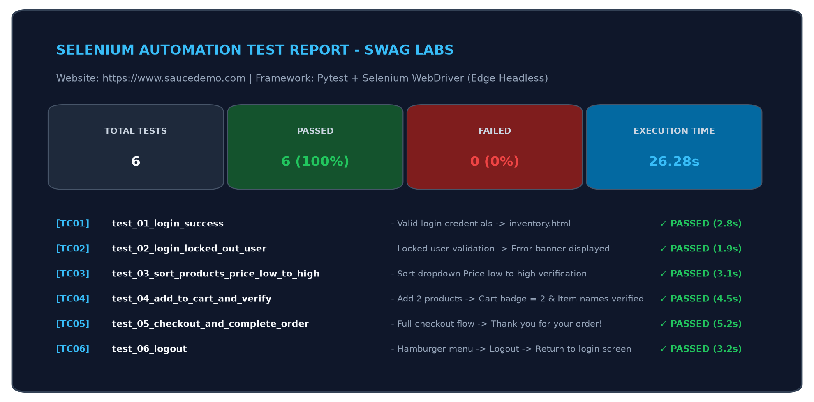
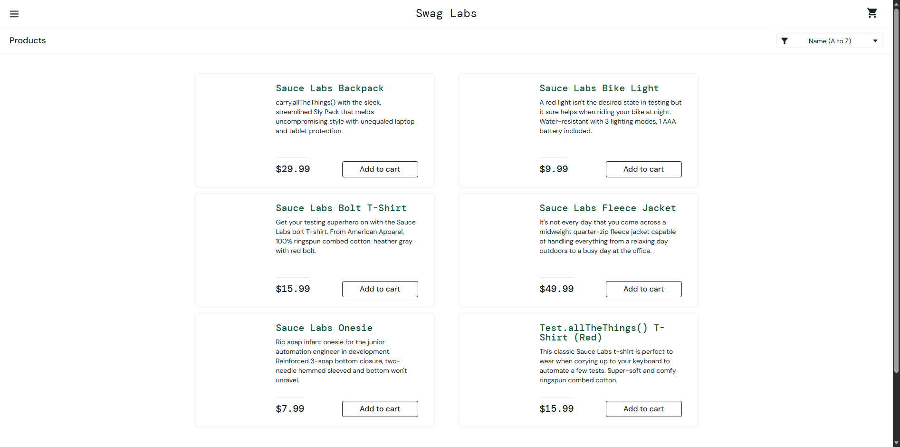
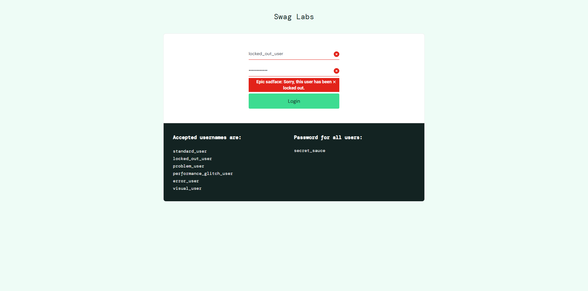
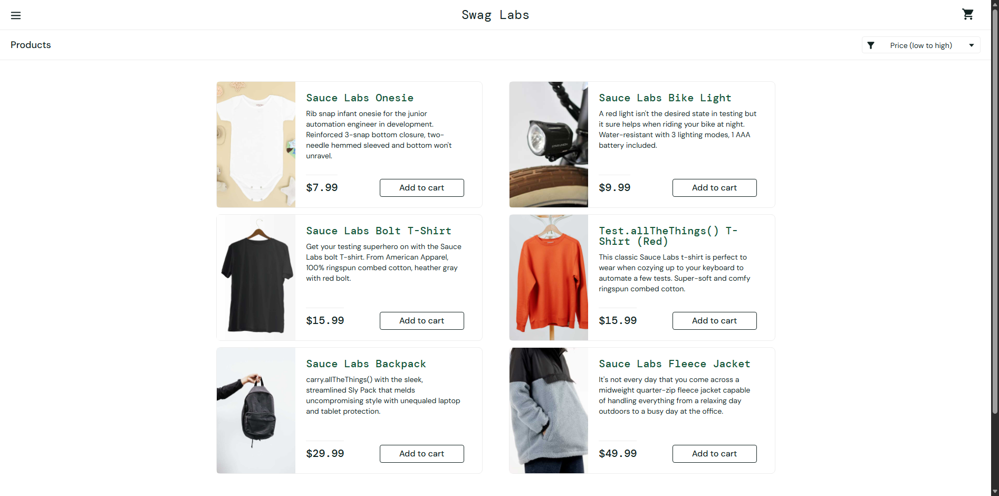
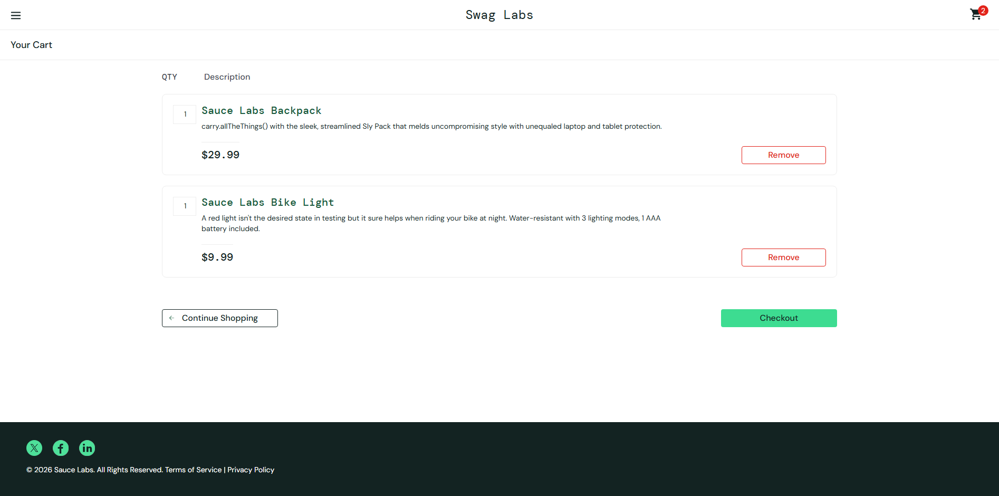
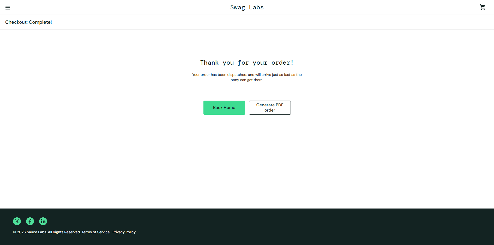
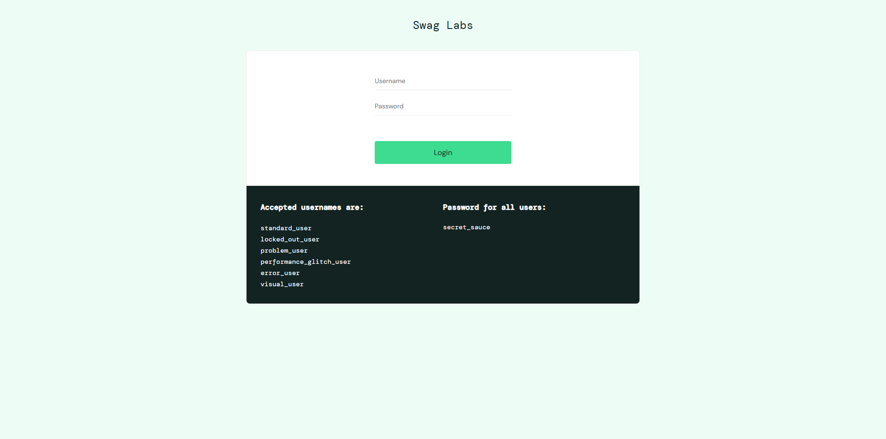

# BÁO CÁO THỰC HÀNH KIỂM THỬ TỰ ĐỘNG UI BẰNG SELENIUM WEBDRIVER


> **MÔN HỌC:** ĐÁNH GIÁ VÀ KIỂM ĐỊNH CHẤT LƯỢNG PHẦN MỀM  
> **GIẢNG VIÊN HƯỚNG DẪN:** TS. Trịnh Thanh Bình  
> **LỚP:** AI&KHDL_1  
> 
> **Sinh viên thực hiện:** **Phạm Duy Quang**  
> **Mã số sinh viên (MSSV):** **23017167**  
> **Ngày thực hiện:** 21/10/2026  
> **Website kiểm thử:** [Swag Labs - SauceDemo](https://www.saucedemo.com/)  
> **Repository GitHub:** [https://github.com/PhamQuang138/DGKTPM](https://github.com/PhamQuang138/DGKTPM)  
> **Thư mục bài làm:** [https://github.com/PhamQuang138/DGKTPM/tree/main/23017167_Selenium_Lab](https://github.com/PhamQuang138/DGKTPM/tree/main/23017167_Selenium_Lab)

---

## 📌 MỤC LỤC
1. [Mục tiêu Bài thực hành](#1-mục-tiêu-bài-thực-hành)
2. [Tài liệu Nghiên cứu & Tham khảo](#2-tài-liệu-nghiên-cứu--tham-khảo)
3. [Kiến trúc Dự án & Mô hình Page Object Model (POM)](#3-kiến-trúc-dự-án--mô-hình-page-object-model-pom)
4. [Bảng Đặc tả 06 Ca Kiểm thử Tự động (Test Cases Specification)](#4-bảng-đặc-tả-06-ca-kiểm-thử-tự-động-test-cases-specification)
5. [Kết quả Thực thi & Hình ảnh Minh họa Chi tiết](#5-kết-quả-thực-thi--hình-ảnh-minh-họa-chi-tiết)
   - [5.0. Tổng quan Báo cáo Thực thi (Test Execution Summary)](#50-tổng-quan-báo-cáo-thực-thi-test-execution-summary)
   - [5.1. TC01: Đăng nhập thành công với tài khoản chuẩn](#51-tc01-đăng-nhập-thành-công-với-tài-khoản-chuẩn)
   - [5.2. TC02: Đăng nhập thất bại với tài khoản bị khóa](#52-tc02-đăng-nhập-thất-bại-với-tài-khoản-bị-khóa)
   - [5.3. TC03: Lọc & Sắp xếp sản phẩm theo giá tăng dần](#53-tc03-lọc--sắp-xếp-sản-phẩm-theo-giá-tăng-dần)
   - [5.4. TC04: Thêm sản phẩm vào giỏ hàng & Xác thực giỏ hàng](#54-tc04-thêm-sản-phẩm-vào-giỏ-hàng--xác-thực-giỏ-hàng)
   - [5.5. TC05: Quy trình Checkout và Hoàn tất đơn hàng](#55-tc05-quy-trình-checkout-và-hoàn-tất-đơn-hàng)
   - [5.6. TC06: Đăng xuất khỏi hệ thống](#56-tc06-đăng-xuất-khỏi-hệ-thống)
6. [Báo cáo Tự động Pytest HTML Report](#6-báo-cáo-tự-động-pytest-html-report)
7. [Hướng dẫn Cài đặt & Chạy Kiểm thử](#7-hướng-dẫn-cài-đặt--chạy-kiểm-thử)
8. [Kết luận & Bài học Kinh nghiệm](#8-kết-luận--bài-học-kinh-nghiệm)

---

## 1. Mục tiêu Bài thực hành

Kiểm thử tự động giao diện người dùng (**Web UI Test Automation**) là một cấu phần quan trọng trong thang kiểm thử phần mềm, giúp đảm bảo tính đúng đắn của hành vi người dùng, bắt các lỗi hồi quy (**Regression Defects**) và rút ngắn thời gian phát hành phần mềm.

Mục tiêu chính của bài thực hành:
- Làm chủ công cụ kiểm thử tự động tiêu chuẩn công nghiệp **Selenium WebDriver 4** trên ngôn ngữ lập trình **Python**.
- Thiết kế và triển khai mã nguồn kiểm thử theo mẫu thiết kế chuẩn **Page Object Model (POM)** nhằm nâng cao tính tái sử dụng, bảo trì và mở rộng của kịch bản kiểm thử.
- Xây dựng bộ kiểm thử hoàn chỉnh vượt yêu cầu tối thiểu (xây dựng **06 test cases**) bao phủ toàn bộ vòng đời thao tác mua hàng của người dùng: *Đăng nhập, Xử lý lỗi đăng nhập, Sắp xếp/Tìm kiếm sản phẩm, Thêm giỏ hàng, Thanh toán đơn hàng, Đăng xuất*.
- Tích hợp công cụ Test Runner **Pytest** và plugin **pytest-html** để tự động xuất báo cáo kết quả kiểm định chuyên nghiệp kèm ảnh chụp màn hình minh chứng.

---

## 2. Tài liệu Nghiên cứu & Tham khảo

Trong quá trình thực hiện bài tập, sinh viên đã nghiên cứu các tài liệu kỹ thuật:
1. **Selenium Official Documentation:** Hướng dẫn chính thức về WebDriver, Locators, Waits và Page Object Model ([https://www.selenium.dev/documentation/](https://www.selenium.dev/documentation/)).
2. **Pytest Documentation (v9.x):** Khung kiểm thử tự động Python, Fixtures, Parametrize và Assertions ([https://docs.pytest.org/](https://docs.pytest.org/)).
3. **Mẫu thiết kế Page Object Model (POM):** Nguyên tắc phân tách trách nhiệm giữa Page Locators, Actions và Test Scripts của Martin Fowler.
4. **Hệ thống thử nghiệm Swag Labs:** [https://www.saucedemo.com/](https://www.saucedemo.com/).

---

## 3. Kiến trúc Dự án & Mô hình Page Object Model (POM)

Dự án được tổ chức khoa học theo mô hình **Page Object Model (POM)**:

```text
23017167_Selenium_Lab/
├── .gitignore                          # Cấu hình bỏ qua virtualenv, cache và file rác
├── requirements.txt                    # Danh sách thư viện Python (Selenium, Pytest, Pytest-HTML)
├── pytest.ini                          # Cấu hình tham số chạy Pytest và tự động xuất báo cáo HTML
├── conftest.py                         # Cấu hình Fixture khởi tạo & đóng trình duyệt Edge Headless
├── README.md                           # Báo cáo thực hành chi tiết kèm hình ảnh minh họa
├── pages/                              # Tầng Page Object: Định nghĩa Locators và Actions
│   ├── __init__.py
│   ├── base_page.py                    # Lớp cơ sở chứa WebDriverWait, click, send_keys, screenshot
│   ├── login_page.py                   # Trang Đăng nhập (Locators: user-name, password, login-button)
│   ├── inventory_page.py               # Trang Danh sách sản phẩm (Lọc giá, Add to cart, Menu)
│   ├── cart_page.py                    # Trang Giỏ hàng (Danh sách món đồ, Nút Checkout)
│   └── checkout_page.py                # Trang Thanh toán (Form thông tin, Tổng tiền, Nút Finish)
├── tests/                              # Tầng Kịch bản Kiểm thử (Test Cases)
│   ├── __init__.py
│   └── test_saucedemo_cases.py         # Bộ 06 Test Cases kiểm thử tự động
├── reports/                            # Báo cáo kết quả và Hình ảnh chụp minh chứng
│   ├── selenium_report.html            # Báo cáo tự động chi tiết dạng HTML
│   └── screenshots/                    # Ảnh chụp màn hình từng bước thực thi
│       ├── TC00_test_execution_summary.png
│       ├── TC01_login_success.png
│       ├── TC02_login_locked_user.png
│       ├── TC03_sort_products_price_low_to_high.png
│       ├── TC04_add_to_cart_and_verify_badge.png
│       ├── TC05_checkout_complete_order.png
│       └── TC06_logout_success.png
└── scripts/
    └── generate_report_card.py         # Script tổng hợp bảng biểu trực quan
```

---

## 4. Bảng Đặc tả 06 Ca Kiểm thử Tự động (Test Cases Specification)

| Mã TC | Tên Ca Kiểm Thử | Phân Hệ | Dữ Liệu Đầu Vào (Test Data) | Các Bước Thực Hiện (Steps) | Kết Quả Mong Đợi (Expected Results) | Trạng Thái |
| :---: | :--- | :---: | :--- | :--- | :--- | :---: |
| **TC01** | Đăng nhập thành công | Xác thực (Auth) | User: `standard_user`<br>Pass: `secret_sauce` | 1. Mở trang đăng nhập<br>2. Nhập username, password<br>3. Nhấn nút Login | - Chuyển sang URL chứa `/inventory.html`<br>- Tiêu đề trang hiển thị `Products` | **PASSED** |
| **TC02** | Đăng nhập thất bại (Tài khoản bị khóa) | Xác thực (Auth) | User: `locked_out_user`<br>Pass: `secret_sauce` | 1. Mở trang đăng nhập<br>2. Nhập tài khoản bị khóa<br>3. Nhấn nút Login | - Hiển thị banner lỗi màu đỏ:<br>`Epic sadface: Sorry, this user has been locked out.` | **PASSED** |
| **TC03** | Lọc & Sắp xếp sản phẩm theo giá tăng dần | Sản phẩm (Inventory) | User: `standard_user`<br>Sort: `lohi` | 1. Đăng nhập hệ thống<br>2. Chọn option `Price (low to high)`<br>3. Đọc danh sách đơn giá | - Giá sản phẩm được sắp xếp tăng dần:<br>`$7.99 <= $9.99 <= ... <= $49.99` | **PASSED** |
| **TC04** | Thêm sản phẩm vào giỏ hàng & Xác thực | Giỏ hàng (Cart) | Sản phẩm:<br>- `Sauce Labs Backpack`<br>- `Sauce Labs Bike Light` | 1. Đăng nhập hệ thống<br>2. Click `Add to cart` 2 sản phẩm<br>3. Kiểm tra icon giỏ hàng<br>4. Mở giỏ hàng kiểm tra | - Icon giỏ hàng hiển thị badge số lượng `2`<br>- Trong giỏ hàng chứa đúng 2 sản phẩm đã chọn | **PASSED** |
| **TC05** | Quy trình Thanh toán & Hoàn tất đơn hàng | Đặt hàng (Checkout) | Họ tên: `Duy Quang Pham`<br>Mã bưu chính: `100000` | 1. Thêm sản phẩm vào giỏ<br>2. Nhấn `Checkout`<br>3. Nhập thông tin giao hàng<br>4. Nhấn `Continue` -> Nhấn `Finish` | - Hiển thị thông báo xác nhận đặt hàng thành công:<br>`Thank you for your order!` | **PASSED** |
| **TC06** | Đăng xuất khỏi hệ thống | Điều hướng (Navigation) | Tài khoản đang đăng nhập | 1. Mở menu điều hướng (Burger menu)<br>2. Nhấp chọn liên kết `Logout` | - Trở về URL trang chủ `saucedemo.com`<br>- Nút Login hiển thị, trường input trống | **PASSED** |

---

## 5. Kết quả Thực thi & Hình ảnh Minh họa Chi tiết

### 5.0. Tổng quan Báo cáo Thực thi (Test Execution Summary)
Bộ kiểm thử tự động đã được thực thi hoàn toàn tự động bằng trình duyệt **Microsoft Edge (Headless Mode)**. Kết quả: **6/6 test cases đạt 100% (PASSED)** trong thời gian **26.28 giây**.



*Hình 1: Bảng tổng quan kết quả thực thi 6/6 test cases tự động bằng Pytest & Selenium WebDriver*

---

### 5.1. TC01: Đăng nhập thành công với tài khoản chuẩn
- **Mục đích:** Kiểm tra luồng xác thực người dùng hợp lệ và chuyển hướng vào trang mua sắm.
- **Thực thi:** Selenium tự động mở trình duyệt, điền thông tin đăng nhập và điều hướng sang `/inventory.html`.



*Hình 2: Màn hình trang danh sách sản phẩm (Products) sau khi đăng nhập thành công với tài khoản standard_user*

---

### 5.2. TC02: Đăng nhập thất bại với tài khoản bị khóa
- **Mục đích:** Kiểm tra cơ chế xử lý ngoại lệ và thông báo lỗi người dùng khi đăng nhập với tài khoản bị vô hiệu hóa.
- **Thực thi:** Nhập tài khoản `locked_out_user`, xác thực thông báo lỗi `Epic sadface: Sorry, this user has been locked out.`.



*Hình 3: Thông báo lỗi hiển thị rõ ràng trên giao diện khi tài khoản bị khóa*

---

### 5.3. TC03: Lọc & Sắp xếp sản phẩm theo giá tăng dần
- **Mục đích:** Kiểm tra chức năng sắp xếp động trên giao diện danh mục sản phẩm.
- **Thực thi:** Chọn dropdown `Price (low to high)`, trích xuất toàn bộ đơn giá và xác nhận mảng giá đã được sắp xếp tăng dần ($7.99 -> $9.99 -> $15.99 -> $29.99 -> $49.99).



*Hình 4: Danh mục sản phẩm đã được lọc và sắp xếp theo thứ tự đơn giá từ thấp đến cao*

---

### 5.4. TC04: Thêm sản phẩm vào giỏ hàng & Xác thực giỏ hàng
- **Mục đích:** Kiểm tra tương tác DOM động khi người dùng thêm sản phẩm và cập nhật Badge giỏ hàng theo thời gian thực.
- **Thực thi:** Nhấn thêm "Sauce Labs Backpack" và "Sauce Labs Bike Light", kiểm tra Badge tăng lên 2, mở trang `/cart.html` đối soát danh sách sản phẩm.



*Hình 5: Trang giỏ hàng hiển thị đúng 2 sản phẩm đã chọn và Badge giỏ hàng hiển thị số lượng 2*

---

### 5.5. TC05: Quy trình Checkout và Hoàn tất đơn hàng
- **Mục đích:** Kiểm tra toàn bộ luồng mua hàng nhiều bước (**Multi-step Checkout Flow**) bao gồm điền địa chỉ giao hàng, tính tổng tiền và xuất biên lai đặt hàng.
- **Thực thi:** Hoàn tất form thông tin giao nhận, xác nhận tổng tiền và nhận thông báo hoàn tất đặt hàng.



*Hình 6: Màn hình xác nhận đơn hàng thành công với thông điệp Thank you for your order!*

---

### 5.6. TC06: Đăng xuất khỏi hệ thống
- **Mục đích:** Kiểm tra phiên làm việc người dùng được hủy bỏ an toàn khi đăng xuất khỏi hệ thống.
- **Thực thi:** Mở Menu điều hướng bên trái, nhấn liên kết Logout và xác thực hệ thống quay trở lại màn hình đăng nhập.



*Hình 7: Giao diện quay trở lại màn hình đăng nhập ban đầu sau khi thực hiện Logout thành công*

---

## 6. Báo cáo Tự động Pytest HTML Report

Dự án tự động sinh file báo cáo HTML độc lập tại [reports/selenium_report.html](reports/selenium_report.html). Báo cáo bao gồm:
- Thông tin môi trường: Python 3.11.7, Pytest 9.1.1, Windows 10/11, Edge 155.0.
- Tổng số test case: **6 passed / 6 total (100% Success)**.
- Thời gian thực thi chi tiết từng ca kiểm thử.

```text
============================= test session starts =============================
platform win32 -- Python 3.11.7, pytest-9.1.1, pluggy-1.7.0
rootdir: D:\DGKTPM\23017167_Selenium_Lab
configfile: pytest.ini
plugins: html-4.2.0, metadata-3.1.1
collected 6 items

tests/test_saucedemo_cases.py::TestSauceDemoAutomation::test_01_login_success PASSED
tests/test_saucedemo_cases.py::TestSauceDemoAutomation::test_02_login_locked_out_user PASSED
tests/test_saucedemo_cases.py::TestSauceDemoAutomation::test_03_sort_products_price_low_to_high PASSED
tests/test_saucedemo_cases.py::TestSauceDemoAutomation::test_04_add_to_cart_and_verify PASSED
tests/test_saucedemo_cases.py::TestSauceDemoAutomation::test_05_checkout_and_complete_order PASSED
tests/test_saucedemo_cases.py::TestSauceDemoAutomation::test_06_logout PASSED

- Generated html report: file:///D:/DGKTPM/23017167_Selenium_Lab/reports/selenium_report.html -
============================== 6 passed in 26.28s ==============================
```

---

## 7. Hướng dẫn Cài đặt & Chạy Kiểm thử

### 7.1. Yêu cầu Tiền đề (Prerequisites)
- **Python:** 3.8 trở lên đã cài đặt trên máy (`python --version`).
- **Trình duyệt:** Microsoft Edge hoặc Google Chrome đã cài đặt.
- **Git:** Đã clone repository về máy tính:
  ```bash
  git clone https://github.com/PhamQuang138/DGKTPM.git
  cd DGKTPM/23017167_Selenium_Lab
  ```

### 7.2. Khởi tạo Môi trường Ảo & Cài đặt Dependencies
```bash
# Tạo môi trường ảo Python
python -m venv .venv

# Kích hoạt môi trường ảo (trên Windows PowerShell):
.\.venv\Scripts\Activate.ps1

# Cài đặt các thư viện cần thiết
pip install -r requirements.txt
```

### 7.3. Thực thi Toàn bộ Test Suite
```bash
# Chạy toàn bộ test cases và tự động xuất báo cáo HTML:
pytest tests/test_saucedemo_cases.py -v -s --html=reports/selenium_report.html --self-contained-html
```

### 7.4. Mở Báo cáo Kết quả
Sau khi chạy xong, mở file [reports/selenium_report.html](reports/selenium_report.html) trên trình duyệt để xem báo cáo tương tác trực quan.

---

## 8. Kết luận & Bài học Kinh nghiệm

Qua bài thực hành, sinh viên đã:
1. **Làm chủ kỹ thuật Selenium WebDriver:** Biết cách tìm kiếm phần tử DOM linh hoạt bằng ID, CSS Selector, Class Name và xử lý đồng bộ hóa bằng `WebDriverWait` (Explicit Wait) thay vì lạm dụng `time.sleep()`.
2. **Nắm vững kiến trúc Page Object Model (POM):** Tách biệt rõ ràng giữa logic giao diện người dùng (Pages) và logic kiểm tra kết quả (Tests), giúp mã nguồn sạch sẽ, dễ bảo trì khi giao diện thay đổi.
3. **Kinh nghiệm xử lý StaleElementReferenceException:** Hiểu rõ cơ chế DOM re-render khi trang web chuyển hướng hoặc tải lại dữ liệu động, từ đó bổ sung các điểm neo đợi URL và phần tử sẵn sàng trước khi tương tác.
4. **Hoàn thiện sản phẩm bàn giao chất lượng:** Đóng gói mã nguồn sạch, có đầy đủ file cấu hình, báo cáo HTML và hình ảnh minh họa chân thực để nộp bài kiểm tra.

---
*Bản quyền báo cáo thuộc về sinh viên Phạm Duy Quang (MSSV: 23017167) - Lớp AI&KHDL_1 - Khoa Công nghệ Thông tin - Trường Đại học Mỏ - Địa chất (HUMG).*
