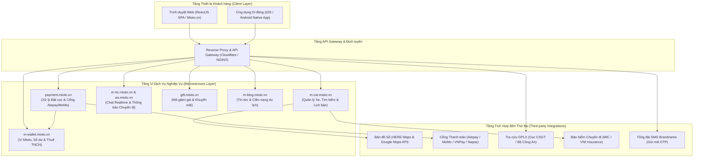
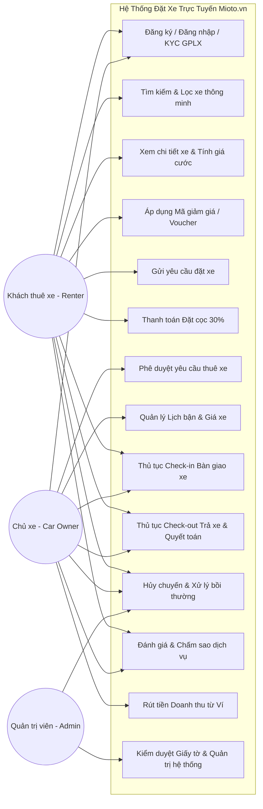
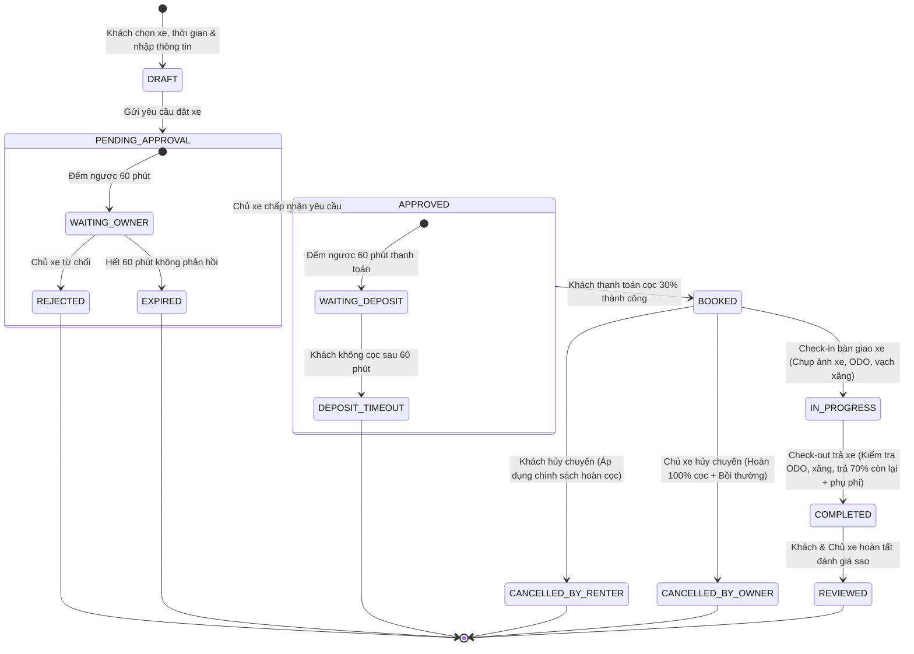

# CHƯƠNG 2: PHÂN TÍCH YÊU CẦU NGHIỆP VỤ VÀ KIẾN TRÚC HỆ THỐNG MIOTO.VN

## 2.1. Kiến trúc Hệ thống Tổng thể (System Architecture & Microservices)

Qua quá trình cào dữ liệu, phân tích mã nguồn client-side ReactJS (bundle chunks `main.bd284d10.chunk.js`, `2.68512f82.chunk.js`), các liên kết tên miền dịch vụ và giao thức mạng của Mioto.vn, hệ thống được xây dựng theo kiến trúc phân tán hướng vi dịch vụ (Microservices Architecture).

### Phân tích chi tiết các phân hệ vi dịch vụ:
1. **Dịch vụ Xe và Tìm kiếm (`m-car.mioto.vn`):**
   - Đảm nhiệm việc lưu trữ metadata của từng phương tiện: biển số xe, hãng sản xuất, dòng xe, năm sản xuất, kiểu dáng thân xe (Sedan/SUV/Hatchback), hộp số (Tự động/Số sàn), loại nhiên liệu (Xăng/Dầu/Điện), mức tiêu hao nhiên liệu.
   - Quản lý bộ sưu tập hình ảnh ngoại thất, nội thất (tối thiểu 4 ảnh chụp thực tế rõ biển số).
   - Quản lý tọa độ vị trí xe (Latitude, Longitude), địa chỉ đỗ xe cố định, phạm vi bán kính hỗ trợ giao xe tận nhà (ví dụ: tối đa 15 km tính từ vị trí đỗ).
   - Quản lý lịch xe bận (Calendar Availability): ghi nhận các khoảng thời gian xe đã có khách đặt hoặc chủ xe bận việc cá nhân để khóa không cho đặt trùng (Double Booking Prevention).
2. **Dịch vụ Thanh toán và Đặt cọc (`payment.mioto.vn`):**
   - Kết nối trực tiếp với cổng thanh toán trung gian Alepay (Ngân Lượng) hỗ trợ Tokenization thẻ tín dụng/ghi nợ quốc tế Visa, MasterCard, JCB.
   - Tích hợp cổng thanh toán ví điện tử: MoMo, VNPay-QR, ZaloPay và thẻ ATM nội địa Napas.
   - Xử lý xác nhận thanh toán tức thời qua cơ chế Webhook (IPN - Instant Payment Notification) và chữ ký số HMAC-SHA256 để bảo vệ tính toàn vẹn của dữ liệu giao dịch.
3. **Dịch vụ Ví và Tài chính Chủ xe (`m-wallet.mioto.vn`):**
   - Quản lý tài khoản số dư khả dụng (Available Balance) và số dư chờ đối soát (Pending Balance) của các chủ xe.
   - Tự động khấu trừ tỷ lệ phí dịch vụ nền tảng (Platform Commission) theo hợp đồng đối tác (thông thường từ 12% đến 15% doanh thu cuốc xe).
   - Thực hiện kê khai và khấu trừ thuế thu nhập cá nhân (TNCN) và thuế GTGT theo quy định của Tổng cục Thuế đối với hình thức kinh doanh vận tải chia sẻ.
   - Tiếp nhận lệnh yêu cầu rút tiền (Withdraw Request) từ chủ xe và đồng bộ với hệ thống ngân hàng.
4. **Dịch vụ Giao tiếp Thời gian thực (`m-rtc.mioto.vn` và `ws.mioto.vn`):**
   - Cung cấp kênh Socket/WebSocket kết nối 2 chiều giữa Khách thuê xe và Chủ xe.
   - Truyền tải tin nhắn văn bản, hình ảnh thỏa thuận địa điểm giao xe và cập nhật trạng thái đơn đặt xe tức thì (Đã gửi yêu cầu -> Chủ xe chấp nhận -> Đã đặt cọc -> Xe đang di chuyển đến).
5. **Dịch vụ Khuyến mãi và Quà tặng (`gift.mioto.vn`):**
   - Quản lý vòng đời mã voucher giảm giá: thời hạn hiệu lực, số lượt sử dụng tối đa, mã dùng một lần cho khách mới (Welcome voucher), mã giảm theo tỷ lệ phần trăm (%), mã giảm tiền trực tiếp (VNĐ), mã áp dụng riêng cho từng dòng xe hoặc từng khu vực địa lý.

---

## 2.2. Đặc tả Yêu cầu Chức năng Hệ thống (Software Requirements Specification - SRS)

Dưới đây là bảng tổng hợp đặc tả yêu cầu chức năng (SRS) của toàn bộ hệ thống Mioto.vn, được chia theo từng phân hệ nghiệp vụ:

| Mã YC (Req ID) | Phân hệ (Module) | Tên chức năng | Mô tả chi tiết yêu cầu kỹ thuật & nghiệp vụ | Ràng buộc & Tiêu chí nghiệm thu |
| :--- | :--- | :--- | :--- | :--- |
| **REQ-AUTH-01** | Xác thực | Đăng ký tài khoản bằng SĐT | Cho phép người dùng nhập SĐT Việt Nam (+84), hệ thống gửi mã OTP gồm 6 chữ số qua SMS. | - SĐT hợp lệ chuẩn E.164 (10 chữ số). - Mã OTP có hiệu lực 60 giây. - Cho phép gửi lại tối đa 3 lần/10 phút. |
| **REQ-AUTH-02** | Xác thực | Xác thực OTP & Thiết lập mật khẩu | Người dùng nhập đúng mã OTP để kích hoạt tài khoản và khởi tạo mật khẩu truy cập. | - Mật khẩu tối thiểu 8 ký tự, gồm chữ hoa, chữ thường và số. - Khóa tạm thời 15 phút nếu nhập sai OTP quá 5 lần. |
| **REQ-AUTH-03** | Xác thực | Đăng nhập tài khoản | Cho phép đăng nhập bằng SĐT + Mật khẩu hoặc đăng nhập nhanh bằng OTP / Google / Facebook. | - Tạo JWT token lưu trữ bảo mật (HttpOnly cookie). - Ghi nhận lịch sử đăng nhập (IP, Thiết bị). |
| **REQ-AUTH-04** | Xác thực / KYC | Định danh GPLX (Bằng lái) | Người dùng tải lên ảnh chụp 2 mặt Giấy phép lái xe hạng B1/B2/C và nhập số GPLX, ngày cấp. | - Hệ thống kiểm tra trùng lặp số GPLX. - Đổi trạng thái sang "Chờ phê duyệt" hoặc tự động duyệt qua API Cục CSGT. |
| **REQ-SRCH-01** | Tìm kiếm | Tìm xe theo địa điểm | Người dùng nhập tên Tỉnh/Thành phố, Quận/Huyện, tên địa danh hoặc chọn vị trí hiện tại trên bản đồ. | - Tích hợp Places Autocomplete của Google/HERE Maps. - Bán kính tìm kiếm mặc định: 10 km. |
| **REQ-SRCH-02** | Tìm kiếm | Tìm xe theo khung thời gian | Cho phép chọn Ngày/Giờ nhận xe và Ngày/Giờ trả xe. | - Thời gian nhận xe phải sau thời điểm hiện tại ít nhất 2 giờ. - Thời lượng thuê tối thiểu là 24 giờ (1 ngày) đối với thuê tự lái. |
| **REQ-SRCH-03** | Bộ lọc | Lọc xe nâng cao | Lọc danh sách xe theo Hãng xe, Kiểu dáng, Hộp số, Nhiên liệu, Mức giá (từ - đến). | - Kết quả lọc cập nhật tức thời mà không cần tải lại toàn bộ trang. - Hiển thị số lượng xe khớp tiêu chí. |
| **REQ-SRCH-04** | Bộ lọc | Lọc tính năng tiện ích | Lọc theo: Giao xe tận nơi, Đặt xe nhanh (Instant Booking), Miễn thế chấp xe máy/tiền mặt, Giảm giá. | - Phân loại rõ các dòng xe đạt chứng chỉ "Chủ xe 5 sao" hoặc "Tỷ lệ phản hồi 100%". |
| **REQ-PRIC-01** | Tính giá | Tính đơn giá ngày cơ bản | Đơn giá niêm yết của từng xe x Số ngày thuê. | - Tính tròn block 24 giờ. Phần giờ dư thừa từ 1-5h tính theo đơn giá giờ; vượt quá 5h tính trọn 1 ngày. |
| **REQ-PRIC-02** | Tính giá | Phụ phí cuối tuần & Ngày Lễ | Tự động cộng thêm phụ phí cuối tuần (T7, CN: +10% đến +20%) hoặc phụ phí Lễ/Tết (Tết Âm lịch, 30/4-1/5, 2/9). | - Bảng giá điều chỉnh tự động theo lịch hệ thống mà chủ xe đã cấu hình trước. |
| **REQ-PRIC-03** | Tính giá | Phí bảo hiểm chuyến đi | Tự động tính phí bảo hiểm vật chất xe (hợp tác MIC/VNI), thông thường từ 10% - 15% đơn giá thuê. | - Khách thuê có thể xem quyền lợi bồi thường: mức khấu trừ bồi thường tối đa (thông thường 2.000.000đ/vụ). |
| **REQ-PRIC-04** | Tính giá | Phí giao nhận xe tận nơi | Tính phí vận chuyển xe đến tận nhà/sân bay của khách: Miễn phí trong bán kính 0-5km; vượt quá tính từ 10.000đ - 15.000đ/km. | - Khoảng cách được tính toán chính xác theo API lộ trình đường bộ (Routing API). |
| **REQ-PRIC-05** | Khuyến mãi | Áp dụng Mã giảm giá (Voucher) | Cho phép nhập mã khuyến mãi, hệ thống kiểm tra tính hợp lệ và giảm trừ trực tiếp vào tổng tiền chuyến. | - Chỉ giảm trên đơn giá thuê gốc (không giảm trên phí bảo hiểm và phí giao xe). - Không áp dụng đồng thời 2 voucher trên 1 đơn. |
| **REQ-BOOK-01** | Đặt xe | Tạo yêu cầu đặt xe | Khách chọn điểm giao nhận, phương thức thanh toán cọc và gửi lời nhắn cho chủ xe. | - Trạng thái đơn: "Chờ chủ xe duyệt" (Pending Approval). - Khóa tạm thời lịch xe trong thời gian chờ duyệt. |
| **REQ-BOOK-02** | Đặt xe | Phê duyệt yêu cầu từ Chủ xe | Chủ xe nhận thông báo qua App/SMS/Web và có tối đa 60 phút để bấm "Đồng ý" hoặc "Từ chối". | - Nếu quá 60 phút không phản hồi, hệ thống tự động hủy đơn và thông báo cho khách. |
| **REQ-BOOK-03** | Đặt cọc | Thanh toán tiền cọc (Deposit) | Khách thanh toán 30% giá trị chuyến đi để hoàn tất giữ xe trong vòng 60 phút kể từ khi chủ xe duyệt. | - Hỗ trợ Thẻ Quốc tế, Thẻ ATM, Ví MoMo, VNPay, Ví Mioto. - Đổi trạng thái sang "Đã đặt cọc" (Booked/Confirmed). |
| **REQ-TRIP-01** | Quản lý chuyến | Thủ tục Check-in (Nhận xe) | Hai bên gặp mặt bàn giao chìa khóa: Khách & Chủ xe chụp tối thiểu 4 ảnh góc xe, ảnh ODO, ảnh vạch xăng. | - Ký hợp đồng thuê xe điện tử trên ứng dụng. - Đổi trạng thái chuyến: "Đang diễn ra" (In Progress). |
| **REQ-TRIP-02** | Quản lý chuyến | Thủ tục Check-out (Trả xe) | Hai bên đối soát tình trạng xe khi kết thúc chuyến, ghi nhận ODO và mức xăng/pin hoàn trả. | - Tính phụ phí vượt km (ví dụ 3.000đ/km nếu vượt quá 300km/ngày). - Tính phụ phí bù xăng nếu mức xăng thấp hơn ban đầu. - Khách thanh toán 70% tiền thuê còn lại + phụ phí trực tiếp cho chủ xe. |
| **REQ-CANC-01** | Hủy chuyến | Khách hủy chuyến theo chính sách | Khách hủy đơn đặt xe theo các mốc thời gian quy định trong chính sách Mioto. | - Hủy trước >7 ngày: Hoàn 100% cọc. - Hủy từ 7 ngày đến >24h: Hoàn 50% cọc. - Hủy dưới 24h: Mất 100% cọc. |
| **REQ-CANC-02** | Hủy chuyến | Chủ xe hủy chuyến | Chủ xe bấm hủy chuyến đã được xác nhận. | - Hoàn 100% cọc cho khách thuê. - Phạt chủ xe 30% giá trị cọc và hạ điểm uy tín trên hệ thống. |
| **REQ-RATE-01** | Đánh giá | Đánh giá chuyến đi | Khách thuê và Chủ xe đánh giá lẫn nhau (từ 1 đến 5 sao kèm bình luận và hình ảnh minh chứng). | - Chỉ mở form đánh giá trong vòng 7 ngày kể từ khi kết thúc chuyến. - Điểm đánh giá cập nhật vào điểm trung bình của xe. |

---

## 2.3. Sơ đồ Ca sử dụng Tổng quát (Use Case Diagram) và Luồng Nghiệp vụ

### 2.3.1. Sơ đồ Use Case Tổng quan Hệ thống Mioto

---

## 2.4. Sơ đồ Máy Trạng thái Vòng đời Chuyến đi (Trip State Machine Diagram)

Trạng thái của một đơn đặt xe (Trip) là thành phần cốt lõi trong toàn bộ hệ thống quản trị dữ liệu của Mioto. Việc hiểu rõ từng bước chuyển trạng thái (State Transition) là cơ sở thiết yếu để thiết kế các ca kiểm thử bao phủ toàn bộ vòng đời của giao dịch.

---

## 2.5. Đặc tả Yêu cầu Phi Chức năng (Non-Functional Requirements - NFR)

1. **Hiệu năng và Thời gian Phản hồi (Performance & Response Time):**
   - Thời gian phản hồi của API Tìm kiếm xe (`/api/cars/search`): $\le 1.5$ giây đối với 95% số yêu cầu (p95 latency) khi có 5.000 người dùng đồng thời.
   - Thời gian tải trang ban đầu (First Contentful Paint - FCP): $\le 1.8$ giây trên mạng 4G tiêu chuẩn.
   - Largest Contentful Paint (LCP): $\le 2.5$ giây theo chuẩn Google Core Web Vitals.
2. **Khả năng Chịu tải và Tính sẵn sàng (Scalability & Availability):**
   - Hệ thống đảm bảo mức độ sẵn sàng đạt SLA 99.9% (thời gian gián đoạn dịch vụ không quá 8.76 giờ/năm).
   - Kiến trúc tự động co giãn (Auto-scaling) đảm bảo chịu tải đột biến vào các dịp cao điểm Lễ, Tết (lưu lượng truy cập tăng 300% - 500%).
3. **Tính An toàn và Bảo mật Thông tin (Security & Data Protection):**
   - Mã hóa toàn bộ dữ liệu truyền tải trên mạng bằng giao thức HTTPS/TLS 1.3.
   - Thông tin thẻ tín dụng/ghi nợ quốc tế tuyệt đối không lưu trữ trên máy chủ Mioto mà được ủy thác qua cơ chế Tokenization của cổng thanh toán chuẩn bảo mật quốc tế PCI-DSS Level 1.
   - Hình ảnh Giấy phép lái xe và Căn cước công dân của người dùng được mã hóa lưu trữ trên Cloud Storage với quyền truy cập giới hạn nghiêm ngặt (Pre-signed URL có thời hạn).
   - Cơ chế phòng vệ chống tấn công DDoS, Rate Limiting đối với API gửi mã OTP (tối đa 3 OTP/10 phút trên một đầu số điện thoại).
4. **Tính Tương thích và Khả năng Đa nền tảng (Compatibility):**
   - Hoạt động mượt mà và hiển thị chính xác (Responsive Design) trên các trình duyệt phổ biến: Google Chrome, Apple Safari, Mozilla Firefox, Microsoft Edge.
   - Hỗ trợ tốt các độ phân giải màn hình từ di động (375px - iPhone SE) đến máy tính để bàn (1920x1080 Full HD).

