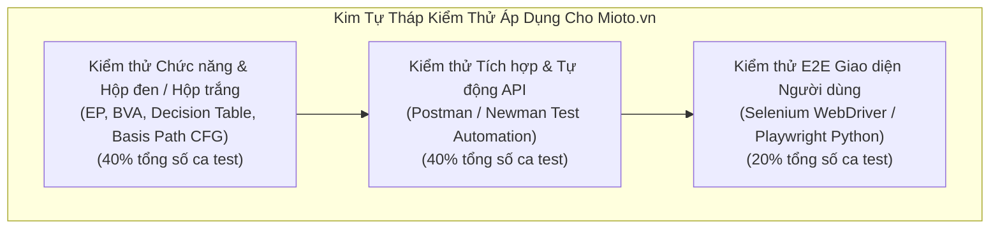

# CHƯƠNG 3: KẾ HOẠCH KIỂM THỬ PHẦN MỀM (TEST PLAN THEO CHUẨN IEEE 829)

## 3.1. Định danh Kế hoạch Kiểm thử (Test Plan Identifier)
- **Mã định danh tài liệu:** `TP-MIOTO-SQA-2026-V1.0`
- **Tên dự án:** Đánh giá chất lượng và kiểm thử chức năng hệ thống đặt xe trực tuyến Mioto (Mioto.vn).
- **Tác giả lập kế hoạch:** Phạm Duy Quang (MSSV: 23017167)
- **Ngày ban hành:** Tháng 10/2026.
- **Tiêu chuẩn áp dụng:** Chuẩn quốc tế IEEE 829-2008 (IEEE Standard for Software and System Test Documentation) kết hợp tiêu chuẩn ISO/IEC/IEEE 29119.

---

## 3.2. Giới thiệu và Mục tiêu Kiểm thử (Test Objectives)

### 3.2.1. Giới thiệu tổng quan:
Kế hoạch kiểm thử này xác định toàn bộ phạm vi, chiến lược, phương pháp tiếp cận, nguồn lực, môi trường và lịch trình thực hiện kiểm thử cho nền tảng web đặt xe trực tuyến Mioto.vn. Bản kế hoạch đóng vai trò kim chỉ nam nhằm bảo đảm mọi quy trình kiểm thử đều được kiểm soát chặt chẽ, có thể định lượng và truy vết nguồn gốc yêu cầu (Traceability).

### 3.2.2. Mục tiêu kiểm thử cụ thể (Quality Goals):
1. **Xác nhận tính đúng đắn về chức năng (Functional Correctness):** Đảm bảo 100% các chức năng cốt lõi (Đăng ký/Đăng nhập, Xác minh GPLX, Tìm kiếm & Lọc xe, Tính toán bảng giá cước, Đặt cọc trực tuyến, Quản lý chuyến đi, Bàn giao xe và Hủy chuyến) hoạt động đúng theo đặc tả nghiệp vụ SRS.
2. **Ngăn ngừa rò rỉ lỗi nghiêm trọng (Zero Critical Defect Leakage):** Loại bỏ hoàn toàn các lỗi ở mức độ nghiêm trọng (Blocker/Critical) liên quan đến tính toán sai lệch tiền cọc, sai lệch chi phí phụ phí, trừ tiền thẻ tín dụng không hợp lệ, hoặc rò rỉ dữ liệu nhạy cảm của khách hàng trước khi bàn giao.
3. **Độ bao phủ kiểm thử cao (High Test Coverage):**
   - Đạt độ bao phủ yêu cầu (Requirements Coverage): $\ge 98\%$.
   - Đạt độ bao phủ đường đi cơ sở (Basis Path Coverage) trong module tính giá: $100\%$.
   - Độ bao phủ kịch bản tự động hóa API (API Automation Coverage): $\ge 85\%$ các endpoint trọng yếu.
4. **Đánh giá mức độ tuân thủ tiêu chuẩn chất lượng ISO/IEC 25010:** Đưa ra bảng điểm định lượng cụ thể cho 8 tiêu chí chất lượng của hệ thống Mioto.vn.

---

## 3.3. Các Hạng mục Kiểm thử và Bàn giao (Test Items & Deliverables)

### 3.3.1. Các hạng mục thuộc đối tượng kiểm thử (Test Items):
- Website khách hàng: `https://www.mioto.vn` (Frontend Single Page Application ReactJS).
- Cổng thông tin chủ xe: `https://www.mioto.vn/owner` và `https://www.mioto.vn/mycars`.
- Các dịch vụ backend RESTful API: Các API Tìm kiếm xe, API Đặt xe, API Tính giá, API Đặt cọc Alepay/MoMo, API Đánh giá.

### 3.3.2. Các sản phẩm bàn giao của quá trình kiểm thử (Test Deliverables):
1. Tài liệu Kế hoạch kiểm thử chi tiết (Test Plan Document - IEEE 829).
2. Bộ đặc tả ca kiểm thử chức năng (Functional Test Cases Specification) gồm hơn 120+ ca kiểm thử chi tiết.
3. Bộ dữ liệu kiểm thử (Test Data Suites).
4. Đồ thị dòng điều khiển (CFG) và phân tích độ phức tạp Cyclomatic Complexity ($V(G)$) cho thuật toán tính cước.
5. Bộ sưu tập kịch bản kiểm thử API tự động (Postman Collection JSON & Newman Runner).
6. Mã nguồn kịch bản kiểm thử giao diện E2E tự động (Selenium / Python Scripts).
7. Báo cáo quản lý lỗi phần mềm (Defect Tracking Matrix & Bug Reports).
8. Ma trận truy xuất nguồn gốc yêu cầu (Requirements Traceability Matrix - RTM).
9. Báo cáo tổng kết và đánh giá chất lượng cuối cùng (Final Test Summary Report).

---

## 3.4. Các Tính năng Cần Kiểm thử và Không Kiểm thử (Features to be Tested / Not Tested)

### 3.4.1. Các tính năng cần kiểm thử (Features to be Tested):
- Phân hệ Xác thực: Đăng ký, Đăng nhập, Quên mật khẩu, Xác thực OTP SMS, Định danh KYC Giấy phép lái xe (GPLX).
- Phân hệ Tìm kiếm & Lọc xe: Tìm theo địa điểm (Autocomplete), tìm theo khoảng thời gian, lọc theo hãng xe, kiểu dáng xe, hộp số, nhiên liệu, tiện ích giao xe tận nơi, đặt xe nhanh.
- Phân hệ Tính giá & Khuyến mãi: Tính đơn giá ngày, phụ phí cuối tuần, phụ phí ngày lễ, phí bảo hiểm vật chất chuyến đi MIC/VNI, phí giao xe theo km, áp dụng mã voucher.
- Phân hệ Đặt xe & Thanh toán: Gửi yêu cầu đặt xe, duyệt đơn từ chủ xe (timeout 60 phút), thanh toán cọc 30% qua thẻ Quốc tế, Thẻ ATM nội địa, Ví MoMo, VNPay, Ví Mioto.
- Phân hệ Vòng đời Chuyến đi: Thủ tục Check-in (chụp ảnh 4 góc xe, ODO, vạch xăng), Thủ tục Check-out (đối soát ODO tính phí vượt km, phụ phí bù xăng, phụ phí xe bẩn/khử mùi).
- Phân hệ Hủy chuyến: Khách hủy chuyến (theo các mốc >7 ngày, 7 ngày đến 24h, <24h), Chủ xe hủy chuyến (hoàn 100% cọc + bồi thường).
- Phân hệ Đánh giá: Chấm sao (1-5 sao) và viết nhận xét dịch vụ.

### 3.4.2. Các tính năng không kiểm thử trong đợt này (Features Not to be Tested):
- Kiểm thử độ bền cơ học và vi mạch của thiết bị phần cứng GPS định vị gắn trên xe ô tô của chủ xe.
- Kiểm thử các chức năng liên quan đến quyết toán sổ sách nội bộ và khai báo thuế doanh nghiệp của bộ phận Kế toán Mioto.
- Kiểm thử khả năng chịu động đất, lũ lụt hoặc mất điện toàn bộ trung tâm dữ liệu đám mây (Disaster Recovery vật lý của nhà cung cấp hạ tầng Cloud).

---

## 3.5. Chiến lược và Phương pháp Tiếp cận Kiểm thử (Testing Strategy)

Chiến lược kiểm thử áp dụng mô hình tiếp cận đa tầng kết hợp giữa kiểm thử tĩnh (Static Testing) và kiểm thử động (Dynamic Testing):

### Các phương pháp kiểm thử cụ thể:
1. **Kiểm thử chức năng hộp đen (Black-box Functional Testing):**
   - **Phân vùng tương đương (Equivalence Partitioning - EP):** Chia tập dữ liệu đầu vào thành các lớp tương đương hợp lệ (Valid Partition) và không hợp lệ (Invalid Partition) đối với các trường: Số điện thoại, Số GPLX, Mật khẩu, Số km thuê xe.
   - **Phân tích giá trị biên (Boundary Value Analysis - BVA):** Tập trung vào các giá trị tại biên và lân cận biên: Thời gian thuê xe tối thiểu (24h), Khoảng cách giao xe miễn phí (0-5km, biên 5km và 5.1km), Giới hạn km/ngày (biên 300km, 301km), Thời gian đếm ngược duyệt đơn (60 phút).
   - **Kiểm thử bảng quyết định (Decision Table Testing):** Áp dụng cho các bài toán logic tổ hợp phức tạp: Quy tắc tính toán tổng chi phí chuyến đi kết hợp nhiều loại phụ phí và chính sách hủy chuyến bồi cọc.
   - **Kiểm thử chuyển trạng thái (State Transition Testing):** Kiểm thử toàn bộ các đường chuyển dịch trạng thái hợp lệ và bất hợp lệ của chuyến đi (Trip Lifecycle).
2. **Kiểm thử hộp trắng (White-box Testing):**
   - Phân tích mã nguồn giải thuật tính giá cước và phụ phí.
   - Xây dựng đồ thị dòng điều khiển (CFG).
   - Đo lường độ bao phủ: Đạt 100% Branch Coverage và Statement Coverage cho các hàm nghiệp vụ trọng yếu.
3. **Kiểm thử phi chức năng (Non-Functional Testing):**
   - Kiểm thử hiệu năng (Performance Testing): Đo lường tải và thời gian đáp ứng của hệ thống.
   - Kiểm thử bảo mật (Security Testing): Đánh giá an toàn xác thực (Broken Authentication), quyền hạn (IDOR/BOLA), kiểm tra an toàn dữ liệu đầu vào (Input Validation, XSS, SQLi).
   - Kiểm thử tính tương thích (Compatibility Testing): Kiểm thử giao diện trên Chrome, Safari, Firefox, Edge và trên các màn hình kích thước khác nhau (Responsive Testing).

---

## 3.6. Tiêu chí Bắt đầu, Tạm dừng, Phục hồi và Kết thúc Kiểm thử

| Tiêu chí | Mô tả chi tiết các điều kiện bắt buộc |
| :--- | :--- |
| **Tiêu chí Bắt đầu (Entry Criteria)** | - Tài liệu đặc tả yêu cầu (SRS) đã được thẩm định và phê duyệt. - Kế hoạch kiểm thử (Test Plan) đã được phê duyệt. - Môi trường kiểm thử (Staging/Testbed) đã được thiết lập và thông suốt kết nối. - Dữ liệu kiểm thử mẫu (Test Data: danh sách xe, tài khoản người dùng, tài khoản chủ xe) đã được khởi tạo. |
| **Tiêu chí Tạm dừng (Suspension Criteria)** | - Môi trường kiểm thử gặp sự cố sập máy chủ, mất kết nối cơ sở dữ liệu quá 2 giờ. - Phát hiện lỗi nghiêm trọng (Blocker/Showstopper) làm tắc nghẽn luồng chính (ví dụ: không thể đăng nhập hoặc API thanh toán bị treo hoàn toàn) khiến không thể tiếp tục thực thi các ca test tiếp theo. |
| **Tiêu chí Phục hồi (Resumption Criteria)** | - Đội ngũ kỹ thuật khắc phục xong lỗi chặn và môi trường kiểm thử được phục hồi trạng thái ổn định. - Các bản vá lỗi (Hotfix) được triển khai và vượt qua bước kiểm thử khói (Smoke Test). |
| **Tiêu chí Kết thúc (Exit Criteria)** | - 100% các ca kiểm thử theo kế hoạch đã được thực thi. - Tỷ lệ Pass của các ca kiểm thử đạt $\ge 95\%$. - 100% các lỗi mức độ Blocker và Critical đã được sửa và retest thành công. - Không còn lỗi mức độ Major chưa được đánh giá giải pháp khắc phục. - Tài liệu Ma trận truy xuất nguồn gốc (RTM) và Báo cáo tổng kết kiểm thử đã được hoàn thiện. |

---

## 3.7. Môi trường Kiểm thử (Test Environment Specification)

| Thành phần | Cấu hình chi tiết | Ghi chú |
| :--- | :--- | :--- |
| **Hệ điều hành kiểm thử** | Windows 11 Pro 64-bit / macOS Sonoma / Ubuntu 22.04 LTS | Đảm bảo bao phủ đa nền tảng OS |
| **Trình duyệt Desktop** | - Google Chrome (v118+) - Mozilla Firefox (v119+) - Microsoft Edge (v118+) - Apple Safari (v17+) | Trình duyệt máy tính tiêu chuẩn |
| **Trình duyệt Mobile / Responsive** | - Chrome Mobile Emulation (iPhone 13/14/15, Samsung Galaxy S23) - Safari iOS trên thiết bị thực iPhone 14 Pro Max | Kiểm thử giao diện di động |
| **Công cụ Kiểm thử API** | Postman v10+ / Newman CLI / Python Requests | Tự động hóa kiểm thử REST API |
| **Công cụ Tự động hóa UI** | Python 3.11 + Selenium WebDriver 4.15 + Playwright | Tự động hóa luồng E2E Web |
| **Cơ sở dữ liệu & Mock Server** | Mockoon / Postman Mock Server mô phỏng các cổng thanh toán và API CSGT | Tránh trừ tiền thẻ tín dụng thật |

---

## 3.8. Phân công Trách nhiệm, Lịch trình & Ma trận Quản lý Rủi ro

### 3.8.1. Phân công vai trò (Roles & Responsibilities):
- **Trưởng nhóm kiểm thử (Test Lead / SQA Engineer - Phạm Duy Quang):**
  - Xây dựng Test Plan, phân tích nghiệp vụ, thiết kế bộ Test Cases chi tiết.
  - Xây dựng mã nguồn kiểm thử tự động API và UI.
  - Phân tích dòng điều khiển hộp trắng và thực thi kiểm thử.
  - Lập báo cáo quản lý lỗi (Bug Reports), ma trận RTM và báo cáo tổng kết chất lượng theo chuẩn ISO 25010.

### 3.8.2. Ma trận Đánh giá và Giảm thiểu Rủi ro Kiểm thử (Risk Matrix):

| Mã Rủi ro | Mô tả rủi ro tiềm ẩn | Mức độ tác động | Khả năng xảy ra | Biện pháp phòng ngừa & Kế hoạch dự phòng (Mitigation Strategy) |
| :--- | :--- | :---: | :---: | :--- |
| **RSK-01** | Cổng thanh toán thật (Alepay, MoMo) yêu cầu trừ tiền tài khoản thực tế. | Cao | Chắc chắn | Sử dụng tài khoản thử nghiệm trên môi trường Sandbox của Alepay và Mockoon Server để giả lập các phản hồi Webhook IPN (Success, Fail, Timeout). |
| **RSK-02** | Cơ chế OTP SMS có thể tốn phí hoặc bị nghẽn mạng viễn thông. | Trung bình | Trung bình | Cấu hình mã OTP cố định trên môi trường kiểm thử (ví dụ: `123456`) đối với danh sách SĐT thử nghiệm nội bộ đã đăng ký trước. |
| **RSK-03** | Website Mioto thay đổi giao diện hoặc thuộc tính CSS/DOM gây gãy kịch bản tự động hóa Selenium. | Trung bình | Thấp | Sử dụng kỹ thuật định danh phần tử bền vững (Robust Selectors: `data-testid`, CSS Selector theo phân cấp ngữ nghĩa) kết hợp mô hình Page Object Model (POM). |
| **RSK-04** | Dữ liệu xe và lịch bận thay đổi liên tục trên môi trường thực tế. | Trung bình | Cao | Tạo dữ liệu xe kiểm thử chuyên dụng (Test Car Listings) có quyền quản trị riêng để chủ động kiểm soát lịch đặt xe mà không làm ảnh hưởng người dùng thật. |

