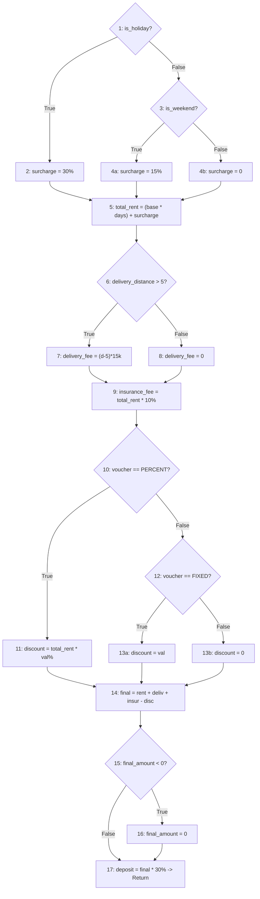

# CHƯƠNG 5: THIẾT KẾ KIỂM THỬ HỘP TRẮNG VÀ KIỂM THỬ DÒNG ĐIỀU KHIỂN (WHITE-BOX TESTING)

## 5.1. Giới thiệu Kỹ thuật Kiểm thử Hộp trắng trong Kiểm thử Phần mềm
Kiểm thử hộp trắng (White-box Testing hay Glass-box / Structural Testing) là phương pháp kiểm thử dựa trên việc xem xét và thấu hiểu toàn bộ cấu trúc mã nguồn nội bộ, luồng dữ liệu và dòng điều khiển của chương trình. Mục tiêu của kiểm thử hộp trắng là:
- Đảm bảo tất cả các câu lệnh (Statements) độc lập đều được thực thi ít nhất một lần.
- Đảm bảo tất cả các quyết định logic (Logical Decisions / Branches) đều được kiểm tra ở cả hai nhánh Đúng (`True`) và Sai (`False`).
- Đảm bảo tất cả các vòng lặp (Loops) hoạt động chính xác tại các giá trị biên và trong giới hạn vận hành.
- Phát hiện các lỗi tiềm ẩn như biến chưa khởi tạo, khối mã không bao giờ chạm tới (Dead code), hoặc sai sót trong biểu thức điều kiện phức tạp.

Trong hệ thống Mioto.vn, module có tính chất logic phân nhánh phức tạp và đóng vai trò quan trọng nhất đối với doanh thu và quyền lợi khách hàng chính là **Thuật toán Tính toán Bảng giá cước và Phụ phí (Pricing and Surcharge Calculator)**.

---

## 5.2. Lựa chọn Hàm Nghiệp vụ và Mã nguồn Thuật toán Tính Giá

Hàm nghiệp vụ được chọn để phân tích kiểm thử hộp trắng là hàm `calculate_rental_price()` chịu trách nhiệm tính toán tổng chi phí cuối cùng mà khách hàng phải thanh toán khi đặt xe, bao gồm: đơn giá ngày, phụ phí cuối tuần, phụ phí ngày lễ, phí giao nhận xe theo khoảng cách, phí bảo hiểm vật chất chuyến đi, và mức chiết khấu từ mã giảm giá voucher.

### Mã nguồn mô phỏng thuật toán tính cước (Python implementation):

```python
def calculate_rental_price(base_rate, days, is_weekend, is_holiday, delivery_distance, voucher_type, voucher_val):
    # Dòng 1: Khởi tạo giá trị chi phí ban đầu
    total_rent = 0
    surcharge = 0
    delivery_fee = 0
    insurance_fee = 0
    discount = 0

    # Dòng 2 (Nút 1): Kiểm tra điều kiện phụ phí ngày Lễ hoặc Cuối tuần
    if is_holiday:                      # Điều kiện 1
        surcharge = base_rate * 0.30 * days
    elif is_weekend:                    # Điều kiện 2
        surcharge = base_rate * 0.15 * days
    else:
        surcharge = 0

    # Dòng 3 (Nút 5): Tính tổng tiền thuê cơ bản gồm cả phụ phí ngày
    total_rent = (base_rate * days) + surcharge

    # Dòng 4 (Nút 6): Tính phí giao xe tận nhà theo khoảng cách (km)
    if delivery_distance > 5:           # Điều kiện 3
        delivery_fee = (delivery_distance - 5) * 15000
    else:
        delivery_fee = 0

    # Dòng 5 (Nút 9): Tự động tính phí bảo hiểm vật chất chuyến đi (10% tổng tiền thuê)
    insurance_fee = total_rent * 0.10

    # Dòng 6 (Nút 10): Tính mức giảm giá từ Voucher khuyến mãi
    if voucher_type == "PERCENT":       # Điều kiện 4
        discount = total_rent * (voucher_val / 100.0)
    elif voucher_type == "FIXED":       # Điều kiện 5
        discount = voucher_val
    else:
        discount = 0

    # Dòng 7 (Nút 14): Tính tổng tiền cuối cùng và số tiền đặt cọc 30%
    final_amount = total_rent + delivery_fee + insurance_fee - discount
    if final_amount < 0:                # Điều kiện 6 (Bảo vệ giá không âm)
        final_amount = 0

    deposit_amount = final_amount * 0.30
    return final_amount, deposit_amount
```

---

## 5.3. Xây dựng Đồ thị Dòng Điều khiển (Control Flow Graph - CFG)

Từ cấu trúc mã nguồn trên, ta phân rã chương trình thành các khối lệnh cơ bản (Basic Blocks) và các nút điều kiện (Predicate Nodes):

- **Nút 1:** Điểm vào hàm; Kiểm tra `if is_holiday`.
- **Nút 2:** Khối xử lý khi `is_holiday == True` (`surcharge = base_rate * 0.30 * days`).
- **Nút 3:** Khối rẽ nhánh kiểm tra `elif is_weekend`.
- **Nút 4a:** Khối xử lý khi `is_weekend == True` (`surcharge = base_rate * 0.15 * days`).
- **Nút 4b:** Khối xử lý nhánh `else` (`surcharge = 0`).
- **Nút 5:** Nút gom nhánh tính ngày: `total_rent = (base_rate * days) + surcharge`.
- **Nút 6:** Nút điều kiện kiểm tra giao xe: `if delivery_distance > 5`.
- **Nút 7:** Khối xử lý khi `delivery_distance > 5` (`delivery_fee = (delivery_distance - 5) * 15000`).
- **Nút 8:** Khối xử lý khi `delivery_distance <= 5` (`delivery_fee = 0`).
- **Nút 9:** Nút gom nhánh giao xe và tính phí bảo hiểm: `insurance_fee = total_rent * 0.10`.
- **Nút 10:** Nút điều kiện kiểm tra voucher: `if voucher_type == "PERCENT"`.
- **Nút 11:** Khối xử lý voucher theo %: `discount = total_rent * (voucher_val / 100.0)`.
- **Nút 12:** Nút điều kiện kiểm tra `elif voucher_type == "FIXED"`.
- **Nút 13a:** Khối xử lý voucher số tiền cố định: `discount = voucher_val`.
- **Nút 13b:** Khối xử lý voucher không hợp lệ hoặc không có: `discount = 0`.
- **Nút 14:** Nút gom nhánh voucher và tính: `final_amount = total_rent + delivery_fee + insurance_fee - discount`.
- **Nút 15:** Nút điều kiện kiểm tra giá âm: `if final_amount < 0`.
- **Nút 16:** Khối gán `final_amount = 0`.
- **Nút 17:** Nút kết thúc: Tính `deposit_amount = final_amount * 0.30` và `return`.

### Sơ đồ Đồ thị Dòng Điều khiển (CFG):



---

## 5.4. Tính toán Độ phức tạp Cyclomatic (Cyclomatic Complexity - $V(G)$)

Độ phức tạp Cyclomatic $V(G)$ của đồ thị dòng điều khiển xác định số lượng đường đi độc lập cơ sở tối thiểu cần có để đảm bảo bao phủ toàn bộ các nhánh rẽ trong chương trình.

### Phương pháp 1: Tính theo số Cung ($E$) và số Nút ($N$)
- Tổng số nút trong đồ thị: $N = 18$ nút (gồm các nút từ 1 đến 17, trong đó các nút 4a, 4b và 13a, 13b được đếm độc lập).
- Tổng số cung (edges) kết nối: $E = 23$ cung.
- Số thành phần liên thông: $P = 1$ (đồ thị đơn).
$$\mathbf{V(G) = E - N + 2P = 23 - 18 + 2(1) = 7}$$

### Phương pháp 2: Tính theo số Nút điều kiện rẽ nhánh (Predicate Nodes - $P$)
Các nút điều kiện trong đồ thị gồm có:
1. Nút 1: `is_holiday` (2 nhánh rẽ)
2. Nút 3: `is_weekend` (2 nhánh rẽ)
3. Nút 6: `delivery_distance > 5` (2 nhánh rẽ)
4. Nút 10: `voucher_type == 'PERCENT'` (2 nhánh rẽ)
5. Nút 12: `voucher_type == 'FIXED'` (2 nhánh rẽ)
6. Nút 15: `final_amount < 0` (2 nhánh rẽ)

Số nút điều kiện $P = 6$.
$$\mathbf{V(G) = P + 1 = 6 + 1 = 7}$$

### Phương pháp 3: Tính theo số Vùng khép kín (Enclosed Regions - $R$)
- Đồ thị có 6 vùng phẳng khép kín $R_1, R_2, R_3, R_4, R_5, R_6$ và 1 vùng mở bao quanh bên ngoài $R_7$.
$$\mathbf{V(G) = \text{Số vùng khép kín} + 1 = 6 + 1 = 7}$$

**Kết luận:** Cả 3 phương pháp độc lập đều cho kết quả độ phức tạp Cyclomatic:
$$\mathbf{V(G) = 7}$$
Điều này khẳng định rằng có **chính xác 7 đường đi cơ sở độc lập (Basis Paths)** cần được bao phủ để đạt 100% độ bao phủ đường đi cơ sở (Basis Path Coverage) và độ bao phủ nhánh (Branch Coverage).

---

## 5.5. Xác định Tập Đường đi Độc lập Cơ sở (Basis Paths Set)

Một tập đường đi độc lập là tập hợp các đường đi sao cho mỗi đường đi mới phải đi qua ít nhất một cung (edge) chưa từng được đi qua bởi các đường đi trước đó:

- **Path 1 (Ngày Lễ, Giao xe xa, Voucher %, Giá dương):**
  $$1 \rightarrow 2 \rightarrow 5 \rightarrow 6 \rightarrow 7 \rightarrow 9 \rightarrow 10 \rightarrow 11 \rightarrow 14 \rightarrow 15 \rightarrow 17$$
  *(Đặc trưng: Kiểm tra nhánh `is_holiday=True`, `distance > 5`, `voucher='PERCENT'`, `final >= 0`)*

- **Path 2 (Ngày Cuối tuần, Nhận tại chỗ, Voucher Cố định, Giá dương):**
  $$1 \rightarrow 3 \rightarrow 4a \rightarrow 5 \rightarrow 6 \rightarrow 8 \rightarrow 9 \rightarrow 10 \rightarrow 12 \rightarrow 13a \rightarrow 14 \rightarrow 15 \rightarrow 17$$
  *(Đặc trưng: Kiểm tra nhánh `is_holiday=False`, `is_weekend=True`, `distance <= 5`, `voucher='FIXED'`)*

- **Path 3 (Ngày Thường, Nhận tại chỗ, Không Voucher, Giá dương):**
  $$1 \rightarrow 3 \rightarrow 4b \rightarrow 5 \rightarrow 6 \rightarrow 8 \rightarrow 9 \rightarrow 10 \rightarrow 12 \rightarrow 13b \rightarrow 14 \rightarrow 15 \rightarrow 17$$
  *(Đặc trưng: Kiểm tra nhánh `is_weekend=False`, `voucher=None`)*

- **Path 4 (Ngày Thường, Giao xe xa, Voucher %, Giá âm -> Về 0):**
  $$1 \rightarrow 3 \rightarrow 4b \rightarrow 5 \rightarrow 6 \rightarrow 7 \rightarrow 9 \rightarrow 10 \rightarrow 11 \rightarrow 14 \rightarrow 15 \rightarrow 16 \rightarrow 17$$
  *(Đặc trưng: Kiểm tra nhánh giá trị âm `final_amount < 0` được kích hoạt và đưa về 0)*

- **Path 5 (Ngày Cuối tuần, Giao xe xa, Không Voucher, Giá dương):**
  $$1 \rightarrow 3 \rightarrow 4a \rightarrow 5 \rightarrow 6 \rightarrow 7 \rightarrow 9 \rightarrow 10 \rightarrow 12 \rightarrow 13b \rightarrow 14 \rightarrow 15 \rightarrow 17$$
  *(Đặc trưng: Kết hợp `is_weekend=True` với `distance > 5` và không voucher)*

- **Path 6 (Ngày Lễ, Nhận tại chỗ, Voucher Cố định, Giá dương):**
  $$1 \rightarrow 2 \rightarrow 5 \rightarrow 6 \rightarrow 8 \rightarrow 9 \rightarrow 10 \rightarrow 12 \rightarrow 13a \rightarrow 14 \rightarrow 15 \rightarrow 17$$
  *(Đặc trưng: Kết hợp `is_holiday=True` với `distance <= 5` và `voucher='FIXED'`)*

- **Path 7 (Ngày Thường, Nhận tại chỗ, Voucher Cố định cực lớn -> Giá âm):**
  $$1 \rightarrow 3 \rightarrow 4b \rightarrow 5 \rightarrow 6 \rightarrow 8 \rightarrow 9 \rightarrow 10 \rightarrow 12 \rightarrow 13a \rightarrow 14 \rightarrow 15 \rightarrow 16 \rightarrow 17$$
  *(Đặc trưng: Kiểm tra nhánh `is_holiday=False`, `voucher='FIXED'`, `final_amount < 0` tại nút 16)*

---

## 5.6. Thiết kế Bộ Ca Kiểm thử Bao phủ Đường đi Cơ sở (Basis Path Test Suite)

Dưới đây là bộ dữ liệu kiểm thử được thiết kế chính xác để kích hoạt từng đường đi trong tập 7 đường đi độc lập cơ sở:

| Test Case ID | Đường đi kiểm thử (Path) | Dữ liệu đầu vào (Input Test Data) | Kết quả kỳ vọng (Expected Output) | Mục tiêu kiểm thử bao phủ |
| :---: | :---: | :--- | :--- | :--- |
| **TC-WB-01** | **Path 1** | `base_rate` = 1.000.000, `days` = 2, `is_holiday` = True, `is_weekend` = False, `delivery_distance` = 10, `voucher_type` = "PERCENT", `voucher_val` = 10 | - Phụ phí lễ: 600.000đ<br/>- Tiền thuê: 2.600.000đ<br/>- Phí giao xe: 75.000đ<br/>- Bảo hiểm: 260.000đ<br/>- Giảm giá: 260.000đ<br/>- **Final: 2.675.000đ**<br/>- **Cọc 30%: 802.500đ** | Bao phủ nhánh Lễ, Giao xe $>5$km, Voucher %, Giá $>0$ |
| **TC-WB-02** | **Path 2** | `base_rate` = 1.000.000, `days` = 2, `is_holiday` = False, `is_weekend` = True, `delivery_distance` = 4, `voucher_type` = "FIXED", `voucher_val` = 100000 | - Phụ phí cuối tuần: 300.000đ<br/>- Tiền thuê: 2.300.000đ<br/>- Phí giao xe: 0đ<br/>- Bảo hiểm: 230.000đ<br/>- Giảm giá: 100.000đ<br/>- **Final: 2.430.000đ**<br/>- **Cọc 30%: 729.000đ** | Bao phủ nhánh Cuối tuần, Giao xe $\le 5$km, Voucher Cố định |
| **TC-WB-03** | **Path 3** | `base_rate` = 1.000.000, `days` = 1, `is_holiday` = False, `is_weekend` = False, `delivery_distance` = 0, `voucher_type` = "NONE", `voucher_val` = 0 | - Phụ phí: 0đ<br/>- Tiền thuê: 1.000.000đ<br/>- Phí giao xe: 0đ<br/>- Bảo hiểm: 100.000đ<br/>- Giảm giá: 0đ<br/>- **Final: 1.100.000đ**<br/>- **Cọc 30%: 330.000đ** | Bao phủ nhánh Ngày thường, Không phụ phí, Không giao xe, Không voucher |
| **TC-WB-04** | **Path 4** | `base_rate` = 100.000, `days` = 1, `is_holiday` = False, `is_weekend` = False, `delivery_distance` = 6, `voucher_type` = "PERCENT", `voucher_val` = 200 (Giả lập giảm 200%) | - Tiền thuê: 100.000đ<br/>- Phí giao: 15.000đ<br/>- Bảo hiểm: 10.000đ<br/>- Giảm giá: 200.000đ<br/>- Tạm tính: $125k - 200k = -75.000$đ<br/>- **Final: 0đ**<br/>- **Cọc 30%: 0đ** | Kích hoạt nhánh bảo vệ giá trị âm `final_amount < 0` (Nút 16) |
| **TC-WB-05** | **Path 5** | `base_rate` = 800.000, `days` = 2, `is_holiday` = False, `is_weekend` = True, `delivery_distance` = 8, `voucher_type` = "INVALID_CODE", `voucher_val` = 0 | - Phụ phí T7/CN: 240.000đ<br/>- Tiền thuê: 1.840.000đ<br/>- Phí giao xe: 45.000đ<br/>- Bảo hiểm: 184.000đ<br/>- Giảm giá: 0đ<br/>- **Final: 2.069.000đ**<br/>- **Cọc 30%: 620.700đ** | Bao phủ nhánh Cuối tuần kết hợp Giao xe $>5$km và Voucher không hợp lệ |
| **TC-WB-06** | **Path 6** | `base_rate` = 1.500.000, `days` = 3, `is_holiday` = True, `is_weekend` = False, `delivery_distance` = 5, `voucher_type` = "FIXED", `voucher_val` = 500000 | - Phụ phí Lễ: 1.350.000đ<br/>- Tiền thuê: 5.850.000đ<br/>- Phí giao xe: 0đ (Biên đúng 5km)<br/>- Bảo hiểm: 585.000đ<br/>- Giảm giá: 500.000đ<br/>- **Final: 5.935.000đ**<br/>- **Cọc 30%: 1.780.500đ** | Bao phủ nhánh Lễ kết hợp biên giao xe $\le 5$km và Voucher tiền |
| **TC-WB-07** | **Path 7** | `base_rate` = 500.000, `days` = 1, `is_holiday` = False, `is_weekend` = False, `delivery_distance` = 2, `voucher_type` = "FIXED", `voucher_val` = 1000000 (Voucher lớn hơn tiền thuê) | - Tiền thuê: 500.000đ<br/>- Phí giao: 0đ<br/>- Bảo hiểm: 50.000đ<br/>- Giảm giá: 1.000.000đ<br/>- Tạm tính: $550k - 1tr = -450.000$đ<br/>- **Final: 0đ**<br/>- **Cọc 30%: 0đ** | Bao phủ nhánh Ngày thường kết hợp Voucher tiền lớn gây giá âm |

---

## 5.7. Đánh giá Mức độ Bao phủ Mã nguồn (Code Coverage Analysis)

Bằng việc thực thi 7 ca kiểm thử cơ sở từ `TC-WB-01` đến `TC-WB-07`:
1. **Độ bao phủ câu lệnh (Statement Coverage):** Đạt **100%** (toàn bộ 18 khối lệnh của hàm đều được thực thi ít nhất một lần).
2. **Độ bao phủ nhánh (Branch Coverage / Decision Coverage):** Đạt **100%** (tất cả 12 hướng rẽ nhánh tại 6 nút điều kiện đều được duyệt qua cả hai trạng thái `True` và `False`).
3. **Độ bao phủ đường đi cơ sở (Basis Path Coverage):** Đạt **100%** (cả 7 đường đi độc lập cơ sở đều được thực thi và kiểm chứng tính toán chính xác).

