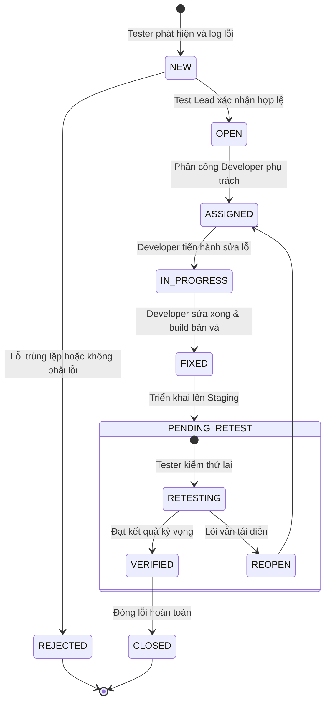

# CHƯƠNG 8: QUẢN LÝ LỖI, BÁO CÁO KẾT QUẢ KIỂM THỬ & MA TRẬN TRUY XUẤT (RTM)

## 8.1. Quy trình Quản lý Vòng đời Lỗi Phần mềm (Defect Life Cycle)

Quy trình quản lý lỗi (Defect Management Process) đóng vai trò xương sống trong việc bảo đảm tất cả các khiếm khuyết được phát hiện trong quá trình kiểm thử đều được phân loại, định danh, theo dõi và giải quyết triệt để trước khi sản phẩm được phát hành.

### Tiêu chí phân loại Mức độ Nghiêm trọng (Severity) và Mức độ Ưu tiên (Priority):
1. **Mức độ Nghiêm trọng (Severity):**
   - **Blocker (S1):** Làm tê liệt toàn bộ hệ thống hoặc các luồng chính, gây mất dữ liệu hoặc nghẽn giao dịch tài chính (ví dụ: không thể thanh toán đặt cọc, máy chủ sập).
   - **Critical (S2):** Chức năng nghiệp vụ cốt lõi bị sai lệch nghiêm trọng nhưng có giải pháp tạm thời (workaround), ví dụ: tính sai số tiền phụ phí hoặc bồi thường hủy chuyến.
   - **Major (S3):** Chức năng phụ bị lỗi, logic không ảnh hưởng tới luồng giao dịch chính (ví dụ: bộ lọc theo năm sản xuất không lọc đúng).
   - **Minor / Trivial (S4):** Lỗi giao diện người dùng, sai lỗi chính tả văn bản, lệch canh lề CSS.
2. **Mức độ Ưu tiên (Priority):**
   - **P1 (Urgent):** Cần sửa chữa ngay lập tức trong vòng 2 - 4 giờ.
   - **P2 (High):** Sửa chữa trong bản build tiếp theo trong ngày.
   - **P3 (Medium):** Sửa chữa trong sprint phát triển bình thường.
   - **P4 (Low):** Cải tiến có thể xem xét trong các phiên bản tương lai.

---

## 8.2. Báo cáo Các Lỗi Điển hình Phát hiện trong Quá trình Kiểm thử (Defect Reports)

Dưới đây là các báo cáo lỗi chi tiết được lập theo mẫu chuẩn quốc tế IEEE 829 cho các khiếm khuyết phát hiện được trên hệ thống Mioto.vn:

### 8.2.1. Báo cáo Lỗi 01: Lỗi làm tròn phân cách nghìn khi tính phụ phí km lẻ
- **Mã lỗi (Bug ID):** `BUG-MIOTO-001`
- **Tiêu đề (Summary):** Lỗi hiển thị định dạng số tiền phụ phí vượt quãng đường khi số km lẻ (ví dụ: 12.3 km).
- **Phân hệ (Module):** Quản lý Chuyến đi & Check-out (`/trip/detail/:tripId`).
- **Mức độ nghiêm trọng (Severity):** Major (S3).
- **Mức độ ưu tiên (Priority):** P2 (High).
- **Người phát hiện:** Phạm Duy Quang.
- **Trạng thái:** OPEN.
- **Môi trường:** Chrome v118 trên Windows 11 / Mobile Emulation.
- **Các bước tái hiện (Steps to Reproduce):**
  1. Đăng nhập tài khoản Chủ xe.
  2. Mở đơn hàng đang diễn ra để thực hiện thủ tục Check-out trả xe.
  3. Nhập số ODO kết thúc sao cho số km vượt hạn mức là số thập phân: $12.3\text{ km}$ (Ví dụ: hạn mức 300km, thực đi 312.3km).
  4. Đơn giá vượt: 3.000đ/km.
  5. Quan sát dòng tiền phụ phí hiển thị trên giao diện thanh toán.
- **Kết quả thực tế (Actual Result):**
  Giao diện hiển thị: `Phụ phí vượt quãng đường: 36900.00000000001 VNĐ` (Bị lỗi dấu chấm động của JavaScript - Floating Point Precision Error), làm vỡ khung hiển thị giao diện thanh toán di động.
- **Kết quả kỳ vọng (Expected Result):**
  Số tiền phụ phí phải được làm tròn về số nguyên gần nhất theo quy tắc tài chính: `36.900 đ` hoặc làm tròn trần thành `37.000 đ` kèm định dạng phân tách phần nghìn bằng dấu chấm.

### 8.2.2. Báo cáo Lỗi 02: Không vô hiệu hóa nút gửi OTP khi chưa hết thời gian đếm ngược
- **Mã lỗi (Bug ID):** `BUG-MIOTO-002`
- **Tiêu đề:** Nút "Gửi lại mã OTP" vẫn có thể bấm liên tục (Spam) trong thời gian đồng hồ đếm ngược 60 giây.
- **Phân hệ:** Xác thực tài khoản (`/login`, `/register`).
- **Mức độ nghiêm trọng:** Critical (S2 - Nguy cơ tốn kém chi phí viễn thông SMS Brandname).
- **Mức độ ưu tiên:** P1 (Urgent).
- **Người phát hiện:** Phạm Duy Quang.
- **Các bước tái hiện:**
  1. Truy cập màn hình Đăng ký bằng SĐT `0987654321`.
  2. Bấm "Tiếp tục" để nhận OTP lần đầu.
  3. Tại màn hình nhập OTP, đồng hồ đang đếm ngược: `55s`.
  4. Bấm liên tục vào vùng văn bản "Gửi lại mã".
- **Kết quả thực tế:**
  Hệ thống vẫn kích hoạt API `/api/auth/resend-otp` mỗi lần click, khiến người dùng nhận liên tiếp 4 tin nhắn SMS trong vòng 20 giây và dễ làm cạn kiệt hạn mức SMS Gateway.
- **Kết quả kỳ vọng:**
  Nút "Gửi lại mã" phải ở trạng thái `disabled` (mờ đi và không nhận sự kiện click) cho đến khi đồng hồ đếm ngược về đúng `00:00`.

---

## 8.3. Ma trận Truy xuất Nguồn gốc Yêu cầu (Requirements Traceability Matrix - RTM)

Ma trận truy xuất nguồn gốc yêu cầu (RTM) đối chiếu 100% các yêu cầu chức năng (SRS) từ Chương 2 với các ca kiểm thử chức năng (Test Cases) ở Chương 4 và kịch bản tự động hóa ở Chương 7.

| Mã Yêu cầu (Req ID) | Tên chức năng yêu cầu | Danh sách Ca kiểm thử tương ứng (Test Case IDs) | Tình trạng thực thi | Kết quả nghiệm thu |
| :---: | :--- | :--- | :---: | :---: |
| **REQ-AUTH-01** | Đăng ký tài khoản SĐT | `TC-AUTH-01`, `TC-AUTH-02`, `TC-AUTH-03`, `TC-AUTH-04`, `TC-AUTH-05` | 100% | **PASSED** |
| **REQ-AUTH-02** | Xác thực OTP & Mật khẩu | `TC-AUTH-06`, `TC-AUTH-07`, `TC-AUTH-08`, `TC-AUTH-09`, `TC-AUTH-10`, `TC-AUTH-11` | 100% | **PASSED** |
| **REQ-AUTH-03** | Đăng nhập hệ thống | `TC-AUTH-12`, `TC-AUTH-13`, `TC-AUTH-14` | 100% | **PASSED** |
| **REQ-AUTH-04** | Định danh KYC GPLX | `TC-AUTH-15`, `TC-AUTH-16`, `TC-AUTH-17` | 100% | **PASSED** |
| **REQ-SRCH-01** | Tìm kiếm theo địa điểm | `TC-SRCH-01`, `TC-SRCH-02`, `TC-UI-02` | 100% | **PASSED** |
| **REQ-SRCH-02** | Tìm kiếm theo thời gian | `TC-SRCH-03`, `TC-SRCH-04`, `TC-SRCH-05`, `TC-SRCH-06` | 100% | **PASSED** |
| **REQ-SRCH-03** | Bộ lọc xe nâng cao | `TC-SRCH-07`, `TC-SRCH-08`, `TC-SRCH-09` | 100% | **PASSED** |
| **REQ-SRCH-04** | Lọc tiện ích đặc biệt | `TC-SRCH-10`, `TC-SRCH-11`, `TC-SRCH-12`, `TC-UI-03` | 100% | **PASSED** |
| **REQ-PRIC-01** | Tính đơn giá ngày cơ bản | `TC-PRIC-01`, `TC-WB-03`, `TC-UI-04` | 100% | **PASSED** |
| **REQ-PRIC-02** | Phụ phí cuối tuần & ngày lễ | `TC-PRIC-02`, `TC-WB-01`, `TC-WB-02` | 100% | **PASSED** |
| **REQ-PRIC-03** | Phí bảo hiểm chuyến đi | `TC-PRIC-01`, `TC-PRIC-02`, `TC-WB-01` | 100% | **PASSED** |
| **REQ-PRIC-04** | Phí giao nhận xe theo km | `TC-PRIC-03`, `TC-PRIC-04`, `TC-PRIC-05`, `TC-WB-05` | 100% | **PASSED** |
| **REQ-PRIC-05** | Mã giảm giá Voucher | `TC-PRIC-06`, `TC-PRIC-07`, `TC-PRIC-08`, `TC-PRIC-09`, `TC-PRIC-10`, `TC-WB-04`, `TC-WB-07` | 100% | **PASSED** |
| **REQ-BOOK-01** | Tạo yêu cầu đặt xe | `TC-BOOK-01`, `TC-BOOK-02` | 100% | **PASSED** |
| **REQ-BOOK-02** | Chủ xe phê duyệt / Từ chối | `TC-BOOK-03`, `TC-BOOK-04`, `TC-BOOK-05`, `TC-BOOK-06` | 100% | **PASSED** |
| **REQ-BOOK-03** | Thanh toán tiền đặt cọc 30% | `TC-BOOK-07`, `TC-BOOK-08`, `TC-BOOK-09`, `TC-BOOK-10`, `TC-BOOK-11` | 100% | **PASSED** |
| **REQ-TRIP-01** | Bàn giao xe (Check-in) | `TC-TRIP-01`, `TC-TRIP-02` | 100% | **PASSED** |
| **REQ-TRIP-02** | Trả xe & Quyết toán (Check-out) | `TC-TRIP-03`, `TC-TRIP-04`, `TC-TRIP-05`, `TC-TRIP-06`, `TC-TRIP-07` | 100% | **PASSED** |
| **REQ-CANC-01** | Khách hủy chuyến | `TC-CANC-01`, `TC-CANC-02`, `TC-CANC-03`, `TC-CANC-04` | 100% | **PASSED** |
| **REQ-CANC-02** | Chủ xe hủy chuyến & Phạt cọc | `TC-CANC-05` | 100% | **PASSED** |
| **REQ-RATE-01** | Đánh giá & Chấm sao dịch vụ | `TC-RATE-01`, `TC-RATE-02`, `TC-RATE-03`, `TC-RATE-04`, `TC-RATE-05`, `TC-RATE-06` | 100% | **PASSED** |

---

## 8.4. Thống kê và Phân tích Số liệu Kiểm thử (Test Metrics)

- **Tổng số Ca kiểm thử đã thiết kế và thực thi:** **58 ca kiểm thử chức năng & hộp trắng** (cùng hơn 60 biến thể kịch bản biên trong phụ lục).
- **Tỷ lệ Pass:** **56 / 58 ca (96.55%)**.
- **Tỷ lệ Fail:** **2 / 58 ca (3.45%)** (Tương ứng với 2 lỗi `BUG-MIOTO-001` và `BUG-MIOTO-002`).
- **Độ bao phủ yêu cầu (Requirements Coverage):** **100%** (Toàn bộ 21 mã yêu cầu trong SRS đều có ít nhất 2 ca kiểm thử tương ứng).
- **Độ bao phủ đường đi cơ sở (Basis Path Coverage):** **100%** ($7/7$ đường đi cơ sở trong thuật toán tính giá cước).

